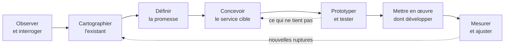

[Sommaire](Readme.md) · [Chapitre suivant →](02-J1-Atelier-Cartographier-le-service.md)

# Jour 1 · Cours — Penser et cartographier un service

> **Jour 1, matin — 3 h 15.** Cet après-midi, vous appliquerez cette démarche à votre brief dans l'[atelier « Cartographier le service »](02-J1-Atelier-Cartographier-le-service.md).

## 🎯 Objectifs

À la fin de cette matinée, vous saurez :

1. Définir un service, dire ce qui le distingue d'un produit, et pourquoi une application n'en est qu'un point de contact.
2. Situer le design de service parmi l'UI, l'UX et la conception logicielle, et en citer les principes.
3. Cartographier l'écosystème d'un service : parties prenantes, flux, systèmes existants.
4. Formuler la promesse d'un service et la décliner en engagements vérifiables.
5. Dessiner un parcours usager cible sur plusieurs canaux, et en repérer les moments de vérité.
6. Lire et construire un service blueprint, et y repérer les points de rupture.

## Déroulé de la matinée

| Horaire | Séquence | Durée |
|---|---|---|
| 09:00 | Ouverture : tour de table, présentation du module, du fil rouge et des exemples | 20 min |
| 09:20 | 1. Qu'est-ce qu'un service ? · 2. Le design de service | 40 min |
| 10:00 | 3. L'écosystème du service, avec l'exercice 1 | 30 min |
| 10:30 | Pause | 15 min |
| 10:45 | 4. La promesse du service · 5. Le parcours et ses moments de vérité, avec l'exercice 2 | 45 min |
| 11:30 | 6. Le service blueprint, avec l'exercice 3 | 60 min |

## Les exemples de la matinée

**Lucioles**, l'exemple du cours. Lucioles est une association qui réunit cinq librairies indépendantes d'une agglomération de 250 000 habitants. Chacune a son fonds, son logiciel de gestion, ses habitudes. Aujourd'hui, un·e lecteur·rice qui cherche un titre précis appelle les librairies une à une, ou se résout à le commander sur une grande plateforme qui le livrera en deux jours. Les libraires notent les réservations sur un carnet ou un post-it ; un livre mis de côté sur six n'est jamais retiré, et il arrive qu'un client se déplace pour un livre vendu entre-temps. L'association veut un service commun : **réserver en ligne un livre disponible dans l'une des cinq librairies, et le retirer le jour même**.

**La cantine**, le sujet des exercices. La restauration scolaire d'une commune de 20 000 habitants : 1 800 enfants inscrits dans neuf écoles, des repas préparés par un prestataire dans sa cuisine centrale et livrés chaque matin, des inscriptions, des réservations et des paiements sur un portail famille, un tarif calculé selon le quotient familial, et quelques enfants qui ont un projet d'accueil individualisé (PAI) pour une allergie.

---

## 1. Qu'est-ce qu'un service ?

### 1.1 Une définition de travail

Un service est une **activité** qu'un prestataire réalise **pour** et **avec** un bénéficiaire, afin de l'aider à obtenir un résultat, sans transfert de propriété. Ce qu'on attend d'un service, ce n'est pas une chose : c'est un **résultat** — être soigné, être transporté, être informé, avoir son livre ce soir — et la manière dont on l'obtient.

Deux conséquences, que l'on retrouvera tout au long du module :

- **L'usager co-produit le service.** Il remplit le formulaire, donne son numéro de téléphone, se déplace au comptoir, apporte le bon justificatif. S'il se trompe dans sa part du travail, le service échoue, et c'est au service de l'avoir prévu.
- **Le service est jugé comme un tout.** Le lecteur ne distingue pas « le site », « la librairie » et « le SMS » : pour lui, c'est Lucioles. Si le livre n'est pas au comptoir, c'est Lucioles qui a échoué, pas « le back-office ».

### 1.2 Quatre traits qui compliquent la conception

Le marketing des services a longtemps décrit les services par quatre traits, que l'on résume par l'acronyme anglais IHIP — *intangibility, heterogeneity, inseparability, perishability*. La grille est discutée — un service numérique se rejoue, se stocke en partie — mais elle reste une très bonne liste de contrôle pour un concepteur.

| Trait | Ce que cela veut dire | Conséquence pour la conception | Chez Lucioles |
|---|---|---|---|
| **Intangible** | on ne peut ni toucher ni essayer un service avant de l'utiliser | rendre le service visible et rassurant : confirmations, statuts, preuves | le SMS « votre livre vous attend jusqu'à samedi » est la seule chose tangible avant le retrait |
| **Inséparable** | il est produit au moment où il est consommé, avec l'usager | l'usager fait partie du processus : ses erreurs sont des cas à prévoir | un numéro de téléphone mal saisi, et le service ne peut plus prévenir personne |
| **Variable** | il change selon la personne qui le rend, le moment, le lieu | standardiser ce qui doit l'être, outiller ce qui varie | un samedi de dédicace, personne ne regarde la tablette du comptoir |
| **Périssable** | il ne se stocke pas : un créneau non utilisé est perdu | gérer la capacité, les pics, les échéances, les files d'attente | un livre mis de côté et jamais retiré est un livre qui ne s'est pas vendu pendant cinq jours |

### 1.3 Le service, l'application et tout le reste

Une application est un **point de contact** du service : parfois le principal, jamais le seul. Le service Lucioles, c'est aussi le libraire qui vérifie le rayon, l'étagère des réservations, le SMS, le comptoir, l'encaissement, la remise en rayon des livres non retirés, et le logiciel de gestion de chaque librairie.

| Ce que le lecteur voit | Ce qu'il ne voit pas |
|---|---|
| une recherche, des librairies qui ont le livre | cinq logiciels de stock, dont trois ne se mettent à jour que la nuit |
| un formulaire, un SMS de confirmation | une tablette qui sonne au comptoir, un libraire qui va vérifier le rayon |
| un livre sur une étagère, un ticket de caisse | une règle d'échéance, une remise en rayon, une purge des données |

> **Le service est jugé à son maillon le plus faible.** Un écran parfait ne rattrape pas un livre introuvable au comptoir.

### 1.4 Pourquoi c'est votre affaire

Imaginons une première version de Lucioles conçue écran par écran : une recherche, un formulaire de réservation, et un e-mail envoyé à la librairie choisie. Elle se code en deux semaines, elle passe tous ses tests… et elle échoue le premier samedi, parce que personne ne lit sa messagerie au comptoir un samedi. Le défaut n'était pas dans le code : il était dans ce que le code ne savait pas.

- **Les besoins les plus coûteux sont en coulisses** : l'outil du libraire, les intégrations avec les logiciels de stock, les relances, les chemins d'erreur. On les découvre tard si on conçoit à partir des écrans, et ils coûtent alors très cher.
- **Le référentiel CDA vous demande de concevoir un système**, pas une interface : définir une architecture suppose de connaître tous les acteurs et tous les échanges.
- **Ce qui n'est pas conçu est bricolé** : un back-office oublié devient un tableur parallèle, une double saisie, un post-it. Vous le retrouverez en maintenance.

---

## 2. Le design de service

### 2.1 D'où vient-il ?

- **1982-1984.** G. Lynn Shostack, cadre dirigeante de banque aux États-Unis — chez Citibank, puis chez Bankers Trust —, publie *How to Design a Service* (European Journal of Marketing, 1982), puis *Designing Services That Deliver* (Harvard Business Review, 1984). Elle y propose de dessiner un service comme un ingénieur dessine une machine, étape par étape, avec une **ligne de visibilité** qui sépare ce que voit le client de tout le reste : c'est le premier **blueprint**.
- **1995-2003.** L'École internationale de design de Cologne (KISD) crée en 1995 la première chaire européenne de design de service, et des écoles italiennes, comme le Politecnico di Milano, s'emparent à leur tour du sujet. Les premières agences spécialisées ouvrent à Londres au début des années 2000.
- **2010-2018.** *This Is Service Design Thinking* (Stickdorn et Schneider, 2010), puis *This Is Service Design Doing* (Stickdorn, Hormess, Lawrence et Schneider, 2018), diffusent les méthodes bien au-delà des agences.
- **En France**, le secteur public s'en est largement emparé : laboratoires d'innovation publique, équipes de design des services numériques de l'État, collectivités qui redessinent leurs démarches à partir de l'expérience des usager·e·s.

### 2.2 Une définition

> Le design de service conçoit tout ce qui permet à un service d'être rendu : les interactions avec les usager·e·s, sur tous les canaux, et ce qui les rend possibles en coulisses — les personnes, les processus, les outils, les règles, les partenaires.

Il conçoit **pour les usager·e·s** et **pour les personnes qui rendent le service** : le libraire qui confirme une réservation entre deux clients est un usager du service, lui aussi. S'il n'y trouve pas son compte, il le contournera.

### 2.3 Six principes

*This Is Service Design Doing* retient six principes. Ils valent autant pour concevoir un logiciel que pour concevoir un service.

| Principe | Ce qu'il dit | Ce qu'il change pour vous |
|---|---|---|
| **Centré sur les humains** | on conçoit pour toutes les personnes concernées : usager·e·s, personnel, partenaires | le back-office du libraire est un livrable, pas un reste |
| **Collaboratif** | on conçoit avec les personnes qui rendent et qui reçoivent le service | faire relire le blueprint par ceux qui font le travail |
| **Itératif** | on explore, on prototype, on teste, on recommence | on teste le service avant de le coder : marche à blanc, pilote |
| **Séquentiel** | un service se déroule dans le temps : avant, pendant, après | penser les états, les délais, les relances, la fin du parcours |
| **Réel** | on s'appuie sur des faits observés, et on teste en conditions réelles | mesurer au lieu de supposer ; prévoir le samedi de dédicace |
| **Holistique** | on considère tout le service : tous les canaux, tout le système, ses effets | l'application n'est qu'un canal ; le téléphone et le comptoir existent toujours |

### 2.4 Quatre échelles de conception

| Échelle | La question qu'elle pose | Son objet | Chez Lucioles |
|---|---|---|---|
| **UI** — interface | L'écran se comprend-il, se manipule-t-il facilement ? | un écran, un composant | le bouton « Réserver » |
| **UX** — expérience | Le produit est-il utile, utilisable, agréable ? | un produit numérique | le site de réservation |
| **Service** | Le résultat promis est-il obtenu, sur tous les canaux, par tous les acteurs ? | le service entier, devant et coulisses | chercher, réserver, être prévenu, retirer, payer |
| **Système** — conception logicielle | Comment réaliser, de façon fiable et sûre, la partie numérique du service ? | l'architecture, les données, les interfaces | les modules, la synchronisation des stocks, l'envoi des SMS |

Le design de service est l'échelle à laquelle on vérifie que l'application **sert à quelque chose** ; la conception logicielle, celle à laquelle on vérifie qu'elle **tient**. Ce module fait le chemin de l'une à l'autre.

### 2.5 La démarche

La démarche suit le **double diamant** du Design Council : on diverge pour comprendre le problème, on converge pour le définir, on diverge à nouveau pour explorer les solutions, on converge pour livrer. Appliquée à un service, elle donne :

Ce module couvre la cartographie, la promesse, la conception du service cible, son test sur table, et le passage à la conception logicielle. La recherche y est réduite au brief et à un entretien avec le commanditaire : en situation réelle, elle prendrait des semaines, et elle irait interroger aussi le personnel, pas seulement les usager·e·s.

---

## 3. L'écosystème du service

### 3.1 Les parties prenantes

Une partie prenante est toute personne, tout groupe ou toute organisation qui **agit** sur le service, qui en est **affecté**, ou qui peut le **faire échouer**. La carte des parties prenantes les range en cercles, de l'usager vers l'environnement :

| Cercle | Qui on y place | Chez Lucioles |
|---|---|---|
| **Au centre** | l'usager, ou les usagers s'ils sont plusieurs | le lecteur ou la lectrice |
| **Au contact** | ceux et ce qui sont en relation directe avec l'usager | les libraires au comptoir, le site, les SMS |
| **En coulisses** | ceux et ce qui travaillent pour le contact, sans être vus | les libraires en réserve, la coordinatrice, les logiciels de gestion |
| **Partenaires** | les organisations extérieures sans lesquelles le service ne tourne pas | les distributeurs, le prestataire SMS, l'hébergeur |
| **Environnement** | ceux qui financent, encadrent, prescrivent ou concurrencent | l'agglomération qui subventionne, la CNIL, les grandes plateformes |

La carte ne suffit pas : il faut aussi dire **ce qui circule** entre les parties prenantes — des informations, des données personnelles, de l'argent, des objets, des décisions. Ce sont ces flux qui deviendront, plus tard, des interfaces.

| De | Vers | Ce qui circule | Nature |
|---|---|---|---|
| Lecteur·rice | Site Lucioles | titre recherché ; nom et téléphone | information ; **données personnelles** |
| Logiciels de gestion | Site Lucioles | état du stock de chaque librairie | information |
| Site Lucioles | Librairie | demande de réservation | information |
| Librairie | Site Lucioles | confirmation ou refus | décision |
| Site Lucioles | Prestataire SMS, puis lecteur·rice | messages, avec le téléphone du lecteur | information ; **données personnelles** |
| Lecteur·rice | Librairie | paiement au retrait, contre le livre | argent ; objet |
| Distributeurs | Librairies | livres, réassort | objet |
| Agglomération | Coordination | subvention, contre un bilan d'activité | argent ; information |

Le prestataire SMS reçoit le téléphone du lecteur : c'est un **sous-traitant** au sens du RGPD, et il faudra un contrat pour l'encadrer. Voilà le genre de chose qu'un tableau de flux fait apparaître tôt.

### 3.2 Les bonnes questions

- **Qui rend le service, qui le reçoit, qui le paie, qui le finance, qui le contrôle ?** Ce ne sont pas toujours les mêmes : à la cantine, le parent paie, l'enfant mange, la commune finance, le prestataire cuisine.
- **Qui peut le faire échouer ?** Cherchez surtout ceux qui doivent faire un effort **sans en tirer de bénéfice** : ce sont eux qui contourneront le service.
- **Qui gagne quoi ?** Chez Lucioles, le libraire gagne des ventes et des appels en moins ; en échange, il doit surveiller une tablette et vérifier un rayon. L'échange doit lui être favorable, sinon la tablette finira dans un tiroir.
- **Quels systèmes existent déjà ?** À qui appartiennent-ils, que savent-ils faire, comment leur parle-t-on ?

### 3.3 Le système d'information existant

On ne conçoit jamais sur une page blanche. Pour chaque système en place, notez son propriétaire, ce qu'il sait, et **comment on lui parle** : API, export de fichier, saisie à la main, rien du tout.

| Système | Propriétaire | Ce qu'il sait | Comment on lui parle |
|---|---|---|---|
| Logiciel de gestion de librairie — trois éditeurs différents | chaque librairie | stock, ventes, commandes aux fournisseurs | deux librairies : API de consultation du stock, en temps réel ; trois librairies : export CSV, chaque nuit |
| Caisse | chaque librairie | encaissements | intégrée au logiciel de gestion |
| Site vitrine de l'association | Lucioles | agenda des rencontres d'auteurs | outil de gestion de contenu, sans catalogue |
| Prestataire SMS | à choisir | envoi des messages, accusés de remise | API HTTP |

La ligne « export CSV, chaque nuit » est la **contrainte de conception la plus importante** de tout le projet Lucioles. Elle dit que le stock affiché peut avoir près de vingt-quatre heures de retard. Le service devra donc faire **confirmer** chaque réservation par un humain avant d'annoncer quoi que ce soit au lecteur. On la retrouvera dans le blueprint, dans le cycle de vie de la réservation et dans les niveaux de service.

### Exercice 1 — L'écosystème de la cantine (10 min)

En binôme, à partir de la présentation de la cantine en tête de chapitre :

1. Listez au moins **douze parties prenantes** et placez-les dans les cinq cercles.
2. Nommez **trois flux**, dont un flux de données personnelles sensibles.
3. Qui peut faire échouer le service **sans en tirer le moindre bénéfice** ?

Voir la correction

**1. Les parties prenantes**

| Cercle | Parties prenantes |
|---|---|
| Au centre | les **parents**, qui réservent et paient ; les **enfants**, qui mangent. Deux usagers, deux expériences très différentes. |
| Au contact | les agents de restauration en salle, les animateur·rice·s périscolaires qui encadrent le repas, le portail famille, l'accueil téléphonique et le guichet du service scolaire |
| En coulisses | le service scolaire de la mairie (inscriptions, facturation), la régie qui encaisse, les directeur·rice·s d'école, qui savent qui est absent |
| Partenaires | le prestataire de restauration (cuisine centrale, livreurs, diététicienne), l'éditeur du portail famille, l'organisme qui fournit le quotient familial, le service de paiement en ligne des collectivités, les médecins qui établissent les PAI |
| Environnement | les élu·e·s, les associations de parents d'élèves, la réglementation de la restauration collective (loi EGAlim), la CNIL |

**2. Trois flux**

- Des **réservations** : du parent vers le portail, puis du portail vers le prestataire, sous forme d'un nombre de repas par école et par jour, la veille.
- De l'**argent** : du parent vers la régie, chaque mois.
- Des **données de santé** : les allergies inscrites au PAI, du médecin vers l'école, puis vers les agents de restauration et le prestataire. Ce sont des données sensibles : qui doit les connaître, sous quelle forme, pendant combien de temps ?

**3. Celui qui peut tout faire échouer**

L'animateur·rice qui **pointe les enfants présents** au repas. Il ou elle n'en retire aucun bénéfice, mais sans ce pointage, la facturation et les quantités commandées sont fausses. Un service bien conçu lui rend la tâche triviale — une liste à jour, un geste par enfant — ou la supprime.

---

## 4. La promesse du service

### 4.1 Ce que l'usager cherche vraiment

Le **canevas de proposition de valeur** (*Value Proposition Canvas*, Osterwalder et al., 2014) met face à face ce que vit l'usager et ce que le service lui apporte.

| Côté usager | Chez Lucioles | Côté service | Chez Lucioles |
|---|---|---|---|
| **Tâches** : ce qu'il cherche à accomplir | trouver un livre précis, vite ; offrir un livre ce soir ; soutenir sa librairie | **Ce que propose le service** | une recherche commune aux cinq librairies, une réservation, un retrait |
| **Problèmes** : ce qui le gêne, ce qu'il redoute | appeler cinq librairies ; se déplacer pour rien ; créer encore un compte | **Ce qui soulage les problèmes** | une seule recherche ; une confirmation humaine avant de se déplacer ; pas de compte |
| **Bénéfices** : ce qu'il espère | l'avoir aujourd'hui ; le conseil du libraire | **Ce qui crée les bénéfices** | le retrait le jour même ; le passage au comptoir, l'occasion d'un conseil |

Le service est ajusté quand ses réponses portent sur les problèmes **les plus importants** pour l'usager, pas sur ceux qui sont les plus faciles à résoudre.

### 4.2 La promesse en une phrase

> Pour **[usager]** qui **[besoin]**, **[service]** permet de **[bénéfice principal]**, contrairement à **[solution actuelle]**.

Pour Lucioles :

> Pour les lecteurs qui veulent un livre précis rapidement sans renoncer à leur librairie, Lucioles indique en une recherche laquelle des cinq librairies du réseau l'a en rayon, et le leur met de côté le jour même, sans compte à créer — là où il faut aujourd'hui appeler chaque librairie, ou attendre deux jours une livraison.

### 4.3 Des engagements vérifiables

Une promesse se décline en **trois à cinq engagements** — on parle aussi de principes de service. Chacun est formulé du point de vue de l'usager, concret, et vérifiable. Ils servent à trancher les débats de conception, et deviendront demain des **niveaux de service** mesurables.

| # | Engagement de Lucioles | Pourquoi |
|---|---|---|
| E1 | « Vous savez en moins de trente minutes si votre livre vous est mis de côté. » | l'attente sans nouvelles est la première cause d'abandon |
| E2 | « Quand on vous dit que c'est prêt, c'est prêt. » | un déplacement pour rien détruit la confiance |
| E3 | « Au comptoir, votre livre est entre vos mains en moins de deux minutes. » | le retrait est le dernier souvenir que laisse le service |
| E4 | « Nous ne vous demandons que votre nom et votre téléphone, et nous les effaçons après trente jours. » | pas de compte, pas de donnée inutile |

Ce qui n'est **pas** un engagement :

- « Offrir une expérience fluide » : invérifiable.
- « Le site est développé en React » : ce n'est pas le point de vue de l'usager.
- « Zéro attente » : intenable, donc personne n'y croira.

> **Un engagement est bon s'il tranche un débat.** « Faut-il envoyer le SMS "prêt" dès la réservation, pour aller plus vite ? » E2 répond : non, seulement après vérification du rayon.

---

## 5. Le parcours usager et ses moments de vérité

### 5.1 Du parcours actuel au parcours cible

La **carte de parcours** raconte, étape par étape, ce que vit un usager pour atteindre un objectif. Elle se lit de gauche à droite et se construit en lignes : les étapes, les actions, les canaux, les points de contact, les pensées et les émotions, les frictions, les opportunités.

- Le **parcours actuel** décrit ce qui se passe aujourd'hui, à partir de faits observés. On le cartographie pour trouver les **ruptures**.
- Le **parcours cible** décrit ce que le service fera se passer. On le dessine pour supprimer les ruptures… sans en créer de nouvelles.

Un parcours a trois temps : **avant**, **pendant** et **après**. L'après est presque toujours oublié : le rappel, la relance, l'annulation, la réclamation, la remise en rayon, l'effacement des données.

### 5.2 Canaux et points de contact

- Un **canal** est un moyen par lequel l'usager et le service communiquent : site, application, téléphone, SMS, e-mail, guichet, courrier, borne.
- Un **point de contact** est une occasion concrète d'interaction : la page de résultats, le SMS de confirmation, le comptoir, l'étiquette sur le livre, le ticket de caisse.
- Un service est **omnicanal** quand l'usager peut commencer sur un canal et finir sur un autre **sans recommencer** : l'information le suit. L'usager ne change pas de service en changeant de canal.
- Une **rupture de canal** se produit quand changer de canal oblige à répéter, à perdre ou à reconstituer une information.

Chez Lucioles, un client qui **téléphone** à la librairie doit pouvoir réserver lui aussi : le libraire saisit la réservation dans le même outil, et le client reçoit le même SMS. C'est une décision de conception, et elle a une conséquence directe sur l'application : le back-office permet de créer une réservation pour quelqu'un d'autre.

### 5.3 Les moments de vérité

L'expression vient de Jan Carlzon, qui dirigeait la compagnie aérienne SAS dans les années 1980 : chaque contact de quelques secondes entre un client et un employé est un **moment de vérité**, où le client se fait son opinion sur toute l'entreprise. Son livre, publié en suédois en 1985 et connu en anglais sous le titre *Moments of Truth* (1987), est paru en français dès 1986 : *Renversons la pyramide !*

En design de service, les moments de vérité sont les **quelques moments du parcours où le service se gagne ou se perd**. Pour les repérer, cherchez :

- l'**intensité** : l'usager est inquiet, pressé, en colère ou soulagé ;
- l'**engagement** : l'usager s'engage, et c'est difficile de revenir en arrière — il se déplace, il paie, il signe ;
- la **dépendance** : l'usager ne peut rien faire d'autre qu'attendre ;
- le **premier et le dernier contact**.

Les travaux de Daniel Kahneman sur la **règle du pic et de la fin** (*peak-end rule*) vont dans le même sens : on se souvient d'une expérience surtout par son moment le plus intense et par sa fin. La fin du parcours compte double.

Un moment de vérité mérite **l'essentiel de l'effort de conception**, un **plan de secours** quand il tourne mal, et une **mesure**. Chez Lucioles :

- **MV1 — la réponse à la recherche.** « Ils l'ont ? » Si l'affichage est faux, tout le reste l'est.
- **MV2 — la confirmation de la mise de côté.** C'est le moment où le lecteur décide de se déplacer.
- **MV3 — le comptoir.** Le livre est-il là, et le retrouve-t-on vite ?

### 5.4 Le parcours cible de Lucioles

| | Découvrir | Chercher | Réserver | Être prévenu | Retirer et payer | Après |
|---|---|---|---|---|---|---|
| **Actions** | entend parler du service par sa librairie ou par une amie | tape un titre ou un ISBN, voit les librairies qui l'ont | choisit une librairie, saisit son nom et son téléphone | reçoit la confirmation, ou un refus avec une solution de repli | vient, donne son code, paie, échange avec le libraire | — |
| **Canaux** | comptoir, affiche, réseaux sociaux | site, sur mobile surtout | site ; ou téléphone à la librairie | SMS, lien de suivi | comptoir | SMS |
| **Points de contact** | marque-page avec un QR code | page de résultats, mention « stock vérifié ce matin à 7 h » | formulaire, page de confirmation, SMS d'accusé | SMS « mis de côté jusqu'à samedi » | étagère des réservations, étiquette, ticket | rappel la veille de l'échéance, si le livre n'est pas retiré |
| **Pensées, émotions** | « Ah, ça existe ? » | « Ils l'ont, à dix minutes de chez moi ! » | « C'est simple. Mais est-ce que c'est sûr ? » | soulagement, ou déception | « Il est là. Et on m'en conseille un autre. » | — |
| **Moments de vérité** | | **MV1** | | **MV2** | **MV3** | |
| **Ruptures possibles** | le service reste inconnu | stock affiché faux | numéro mal saisi | pas de réponse, ou réponse tardive | livre introuvable, file d'attente | relances trop nombreuses ; livre immobilisé |

### Exercice 2 — Les ruptures du parcours de la cantine (10 min)

Voici le parcours **actuel** d'une mère qui doit signaler l'absence de son fils malade.

1. **7 h 30.** Inès constate que Lucas, en CE1, a de la fièvre. Elle ouvre le portail famille sur son téléphone : les réservations du jour ne sont plus modifiables depuis 9 h la veille.
2. **8 h 10.** Elle appelle l'école : répondeur. Elle laisse un message.
3. **8 h 15.** Elle envoie un e-mail au service scolaire pour demander que le repas ne soit pas facturé. Elle reçoit un accusé de réception automatique.
4. **9 h 00.** La directrice écoute le message et note l'absence dans le cahier d'appel. Personne ne prévient la cantine.
5. **12 h 00.** L'animatrice pointe les enfants présents sur une liste papier. Le repas de Lucas est jeté.
6. **Le mois suivant.** La facture compte le repas. Inès appelle le service scolaire, qui lui demande un certificat médical, à déposer au guichet, ouvert en semaine de 8 h 30 à 12 h.

En binôme :

1. Listez les canaux utilisés et chaque changement de canal.
2. Où sont les ruptures, c'est-à-dire les endroits où une information est perdue ou doit être répétée ?
3. Quel est le moment de vérité de ce parcours ?
4. Formulez un engagement pour le service cible.

Voir la correction

**1. Les canaux.** Portail web, téléphone et répondeur, e-mail, cahier d'appel, liste de pointage papier, facture, téléphone à nouveau, guichet : **sept changements de canal** pour une seule intention, « mon fils ne mangera pas à la cantine aujourd'hui ».

**2. Les ruptures.**

- **Portail → téléphone** : le portail ne propose aucune voie pour l'imprévu. La règle de la veille à 9 h est un mur, sans porte de sortie.
- **École → cantine** : l'information existe dès 9 h, mais elle ne circule pas. C'est une rupture **en coulisses**, invisible pour Inès : elle croit avoir prévenu.
- **E-mail → facturation** : la demande d'Inès n'est reliée ni au pointage, ni à la facture.
- **Facture → guichet** : la demande de justificatif arrive un mois plus tard, sur un canal ouvert seulement aux heures de bureau.

**3. Le moment de vérité.** **La facture.** C'est là qu'Inès découvre que le service ne l'a pas entendue, et c'est la fin du parcours : c'est ce dont elle se souviendra. On peut défendre aussi 7 h 30, le moment où elle a besoin d'une solution et n'en trouve pas : c'est là que la rupture commence.

**4. Un engagement.** « Une absence signalée avant 10 h n'est pas facturée, quel que soit le canal utilisé pour la signaler. » Ou bien : « Vous signalez une absence une seule fois, à un seul endroit. »

---

## 6. Le service blueprint

### 6.1 Ce que montre un blueprint

Le parcours montre ce que vit l'usager. Le **blueprint** montre **ce qui le rend possible** : pour chaque étape du parcours, ce que fait l'usager, ce qu'il voit, qui agit devant lui, qui agit en coulisses, et quels systèmes soutiennent l'ensemble. Proposé par Shostack au début des années 1980, il a pris sa forme actuelle avec les travaux de Bitner, Ostrom et Morgan (2008).

**Un blueprint, un scénario** : un usager, un objectif, un chemin — le chemin nominal, ou un incident précis. Un blueprint qui veut tout montrer ne montre rien.

### 6.2 Anatomie

| Couloir, de haut en bas | Ce qu'on y met | Chez Lucioles |
|---|---|---|
| **Preuves physiques** | ce que l'usager voit, touche ou reçoit à chaque étape | page de résultats, SMS, étiquette, ticket |
| **Actions de l'usager** | ce que fait l'usager, étape par étape : l'épine dorsale du blueprint | chercher, réserver, être prévenu, retirer |
| *ligne d'interaction* | au-dessus, l'usager ; au-dessous, le service | |
| **Frontstage** | ce que le service fait sous les yeux de l'usager : personnel au contact, interfaces | le libraire au comptoir ; le site ; les SMS |
| *ligne de visibilité* | au-dessus, ce que l'usager voit ; au-dessous, ce qu'il ne voit pas | |
| **Backstage** | ce que le personnel fait en coulisses pour que le frontstage tienne | le libraire vérifie le rayon, met de côté, confirme |
| *ligne d'interaction interne* | au-dessus, ceux qui sont au contact ou travaillent pour eux ; au-dessous, les fonctions et systèmes qui les soutiennent | |
| **Processus support** | systèmes, services internes, partenaires | synchronisation des stocks, envoi des SMS, logiciel de caisse |

Pour un service numérique, **séparez le frontstage en deux** : un frontstage **humain** et un frontstage **numérique**. On voit alors immédiatement où l'interface remplace une personne, et où elle doit lui passer le relais.

Les annotations se posent directement sur les cases :

| Repère | Signification | Pourquoi le noter |
|---|---|---|
| ⚠ **F** | point de rupture (*fail point*) : ce qui peut échouer | ce sont vos cas d'erreur, et vos plans de secours |
| ⌛ **A** | attente : l'usager attend quelque chose | ce sont vos exigences de délai |
| ★ **MV** | moment de vérité | c'est là que l'effort et la mesure se concentrent |
| **D** | données manipulées | ce sont vos objets du domaine, et vos données personnelles |
| **RG** | règle de gestion | ce sont vos règles métier, à coder et à tester |

### 6.3 Le blueprint de Lucioles

**Scénario :** Malik, 34 ans, cherche un roman pour l'anniversaire de sa sœur, ce soir. Le livre est en rayon dans l'une des librairies du réseau.

| | 1. Chercher | 2. Réserver | 3. Être prévenu | 4. Retirer et payer | 5. Après |
|---|---|---|---|---|---|
| **Preuves physiques** | résultats : deux librairies, mention « stock vérifié ce matin à 7 h » | page « demande envoyée, réponse sous 30 min » ; SMS d'accusé | SMS « mis de côté à la librairie du Port jusqu'à samedi 18 h, code R-4821 » | étagère des réservations, étiquette R-4821, ticket de caisse | aucun message de plus |
| **Actions de l'usager** | tape le titre | choisit la librairie du Port, saisit nom et téléphone | lit le SMS, décide de passer à 17 h | donne son code, paie, discute | — |
| *ligne d'interaction* | | | | | |
| **Frontstage numérique** | recherche, disponibilités par librairie ★ MV1 | formulaire, page de confirmation | SMS, page de suivi ★ MV2 | — | — |
| **Frontstage humain** | — | — | — | le libraire retrouve le livre, encaisse, conseille ★ MV3 | — |
| *ligne de visibilité* | | | | | |
| **Backstage** | — | la tablette du comptoir sonne : nouvelle demande | le libraire vérifie le rayon, étiquette le livre, le range, confirme sur la tablette ⚠ F2 ⌛ A1 | le libraire marque la réservation « retirée » à l'encaissement ⚠ F5 | à l'échéance, le libraire remet en rayon les livres non retirés ⚠ F4 |
| *ligne d'interaction interne* | | | | | |
| **Processus support** | agrégation des stocks : API en temps réel pour deux librairies, import CSV nocturne pour trois ⚠ F1 | création et horodatage de la réservation **D** | envoi du SMS par le prestataire, accusé de remise ⚠ F3 | vente enregistrée dans le logiciel de la librairie | effacement des données à 30 jours **RG** |

Les points de rupture, et ce que le service cible en fait :

| Rupture | Ce qui se passe | Ce que prévoit le service |
|---|---|---|
| ⚠ F1 | le stock affiché est faux : l'export date de la nuit, le livre a été vendu le matin | la confirmation humaine de l'étape 3 protège le lecteur ; la page affiche l'heure du stock |
| ⚠ F2 | la demande n'est pas vue : rush du samedi, tablette dans l'arrière-boutique | sonnerie, relance à 20 min, puis message honnête au lecteur à 30 min |
| ⚠ F3 | le SMS n'arrive pas : numéro mal saisi | numéro saisi deux fois, accusé de remise, page de suivi accessible par le lien |
| ⚠ F4 | le livre n'est jamais retiré, il reste immobilisé | échéance courte, rappel la veille, liste des livres à remettre en rayon |
| ⚠ F5 | le livre est introuvable au comptoir | étiquette au code de réservation, étagère rangée par code |

L'attente ⌛ A1, entre la demande et la confirmation, est celle de l'engagement E1 : moins de trente minutes. Et si la demande arrive à 22 h ? La librairie est fermée : la page de confirmation l'annonce — « réponse dès l'ouverture, demain à 10 h » —, et le délai ne court qu'à partir de l'ouverture. C'est une **règle de gestion**, et elle se décide maintenant, pas pendant le développement.

### 6.4 Lire un blueprint

- **Verticalement.** Pour chaque action de l'usager, qu'est-ce qui la rend possible, jusqu'en bas ? Une action sans rien en dessous est une promesse sans moyens.
- **Horizontalement.** Suivez un couloir de bout en bout : que fait le libraire sur tout le parcours ? Est-ce tenable un samedi de dédicace ?
- **Aux frontières.** Chaque flèche qui traverse une ligne est un **passage de relais**, et c'est aux passages de relais que les services cassent.
  - Traverser la **ligne de visibilité**, c'est décider de ce que l'usager voit, et de ce qu'il ne doit pas voir. Les étiquettes de l'étagère portent un **code**, pas le nom du client : les autres clients voient l'étagère.
  - Traverser la **ligne d'interaction interne**, c'est un contrat entre des personnes ou entre des systèmes : qui transmet quoi, quand, sous quelle forme.
- **Dans les vides.** Une étape sans preuve physique laisse l'usager dans le noir : c'est l'intangibilité. Une tâche en coulisses sans système pour la porter sera faite à la main, et elle sera oubliée.

### 6.5 Construire un blueprint, en sept étapes

1. **Choisir le scénario** : un usager, un objectif, un chemin. Commencez par le chemin nominal, puis faites un blueprint par incident majeur.
2. **Poser les actions de l'usager**, de gauche à droite, à partir du parcours cible.
3. **Ajouter les preuves physiques** au-dessus de chaque action.
4. **Ajouter le frontstage** : qui ou quoi est au contact, humain ou numérique ?
5. **Descendre en coulisses** : que faut-il faire, avant ou pendant, pour que le frontstage tienne ?
6. **Ajouter les processus support** : quels systèmes, quels partenaires, quelles données ?
7. **Annoter** — ruptures, attentes, moments de vérité, données, règles —, puis faire relire par les personnes qui font le travail.

Sur un mur, prenez **une couleur de post-it par couloir**, tracez les trois lignes au ruban adhésif, et reliez par des flèches les cases qui dépendent l'une de l'autre.

| Erreur fréquente | À quoi on la reconnaît | Le remède |
|---|---|---|
| Le blueprint d'un site | les colonnes sont des pages | les colonnes sont des étapes vécues par l'usager |
| Le blueprint de tout | trois scénarios mélangés, des « ou » partout | un scénario par blueprint |
| Des coulisses vides | rien sous la ligne de visibilité, sauf « le système » | nommer qui fait quoi, avec quel outil |
| Le système magique | « le système gère » | quel système, quelle donnée, quel déclencheur ? |
| Aucune rupture | tout se passe toujours bien | à chaque case : « et si… ? » |
| Le service idéal | aucune contrainte, aucun système existant | partir des systèmes en place et des contraintes réelles |

### Exercice 3 — Le blueprint de l'absence (20 min)

Voici le blueprint, à compléter, du parcours **cible** : « Inès signale à 7 h 30, sur le portail, l'absence de Lucas pour la journée ; le repas ne lui est pas facturé. »

| | 1. Signaler | 2. Être rassurée | 3. Le repas de midi | 4. La facture |
|---|---|---|---|---|
| **Preuves physiques** | ? | message « absence de Lucas enregistrée pour aujourd'hui, repas non facturé » | — | facture sans le repas du jour |
| **Actions de l'usager** | ouvre le portail, choisit Lucas, « absent aujourd'hui » | lit le message | — | consulte la facture |
| *ligne d'interaction* | | | | |
| **Frontstage numérique** | ? | message de confirmation | — | facture sur le portail |
| **Frontstage humain** | — | — | ? | — |
| *ligne de visibilité* | | | | |
| **Backstage** | — | ? | ? | ? |
| *ligne d'interaction interne* | | | | |
| **Processus support** | le portail enregistre l'absence | ? | ? | facturation : réservations moins absences |

En équipe de trois ou quatre :

1. Complétez les cases marquées « ? ».
2. Placez au moins **deux points de rupture** et **une attente**.
3. Quels échanges traversent la ligne d'interaction interne ?

Voir la correction

**1. Les cases manquantes**

| Case | Proposition |
|---|---|
| Preuves, étape 1 | un bouton « signaler une absence » toujours visible, même après la clôture des réservations ; un écran de confirmation |
| Frontstage numérique, étape 1 | un formulaire : enfant, date ou période, motif **facultatif**. Un motif de santé est une donnée sensible : on ne l'exige pas. |
| Frontstage humain, étape 3 | l'animatrice pointe les présents sur une liste où Lucas apparaît **déjà** absent |
| Backstage, étape 2 | la directrice reçoit la liste des absences du jour : plus besoin du répondeur |
| Backstage, étape 3 | l'animatrice dispose d'une liste à jour avant le repas |
| Backstage, étape 4 | rien : le service scolaire n'a plus à traiter de réclamation. C'est un gain à faire valoir. |
| Support, étape 2 | notification à l'école ; transmission au prestataire du nombre de repas corrigé, pour les jours suivants |
| Support, étape 3 | liste de pointage produite à partir des réservations et des absences, imprimée ou sur tablette |

Une subtilité : la cuisine centrale produit les repas du jour **dès l'aube**, à partir des réservations de la veille. Le repas de Lucas sera donc préparé quoi qu'il arrive. Ne pas le facturer est une **règle de gestion** décidée par la commune, pas une conséquence technique : notez-la **RG** sur le blueprint, et faites-la valider par le commanditaire.

**2. Ruptures et attente**

- ⚠ F : l'absence est signalée **après** l'impression de la liste de pointage. L'animatrice a une liste périmée.
- ⚠ F : le parent signale l'absence pour la mauvaise date, ou pour le mauvais enfant.
- ⚠ F : l'école n'est pas informée, parce qu'on a oublié ce lien en concevant le portail.
- ⌛ A : le délai entre le signalement et la mise à jour de la liste de pointage.

**3. Les échanges qui traversent la ligne d'interaction interne**

Du portail vers le **prestataire** (nombre de repas), du portail vers l'**école** (absences du jour), du portail vers la **facturation**. Trois échanges, donc trois interfaces à concevoir, donc trois contrats : qui envoie quoi, quand, sous quelle forme, et que se passe-t-il quand ça échoue ?

---

## 📁 Dossier de projet

Pour la compétence *Analyser les besoins et maquetter une application*, reprenez dans votre dossier :

- la **carte de l'écosystème**, systèmes existants compris, avec les flux principaux ;
- la **promesse** et les **engagements** du service ;
- le **parcours cible**, avec ses moments de vérité ;
- le **blueprint du scénario principal**, annoté, et au moins un **blueprint d'incident**.

Devant le jury, montrez le blueprint, pointez **un** point de rupture, et dites ce que votre application en fait. C'est la démonstration la plus courte qui soit que vous avez analysé le besoin.

## Ce qu'il faut retenir

- Un service est une activité co-produite avec l'usager ; une application n'en est qu'un point de contact.
- Le design de service conçoit le devant et les coulisses ; les ruptures sont presque toujours dans les coulisses, aux passages de relais.
- L'écosystème comprend ceux qui peuvent faire échouer le service, et les systèmes qui existent déjà.
- Une promesse se décline en engagements vérifiables, qui tranchent les débats de conception.
- Les moments de vérité concentrent l'effort, le plan de secours et la mesure ; la fin du parcours compte double.
- Un blueprint, un scénario. Il se lit verticalement, horizontalement, aux frontières et dans les vides.

## Pour aller plus loin

- G. Lynn Shostack, [*Designing Services That Deliver*](https://hbr.org/1984/01/designing-services-that-deliver), Harvard Business Review, 1984 — l'article fondateur du blueprint, en anglais.
- Mary Jo Bitner, Amy Ostrom et Felicia Morgan, *Service Blueprinting: A Practical Technique for Service Innovation*, California Management Review, 2008 — la forme moderne du blueprint, en anglais.
- Marc Stickdorn, Markus Hormess, Adam Lawrence et Jakob Schneider, *This Is Service Design Doing*, O'Reilly, 2018 — le manuel de référence ; [ses méthodes](https://www.thisisservicedesigndoing.com/) sont en accès libre, en anglais.
- Nielsen Norman Group, [*Service Blueprints: Definition*](https://www.nngroup.com/articles/service-blueprints-definition/) — une présentation courte et illustrée, en anglais.
- Alexander Osterwalder et al., *Value Proposition Design*, 2014 — le canevas de proposition de valeur.
- Jan Carlzon, *Renversons la pyramide ! Pour une nouvelle répartition des rôles dans l'entreprise*, InterÉditions, 1986 — les moments de vérité, racontés par celui qui les a nommés.

---

[Sommaire](Readme.md) · [Chapitre suivant →](02-J1-Atelier-Cartographier-le-service.md)
