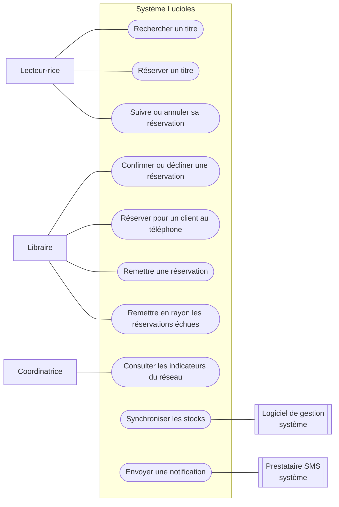
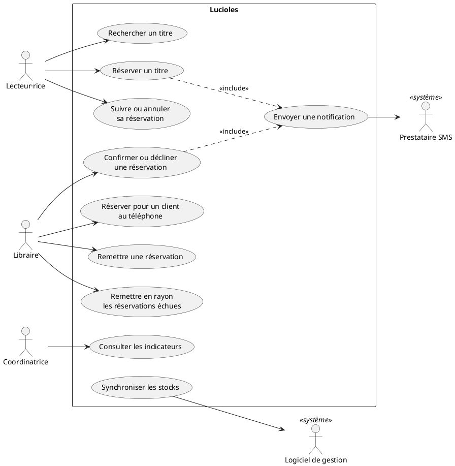
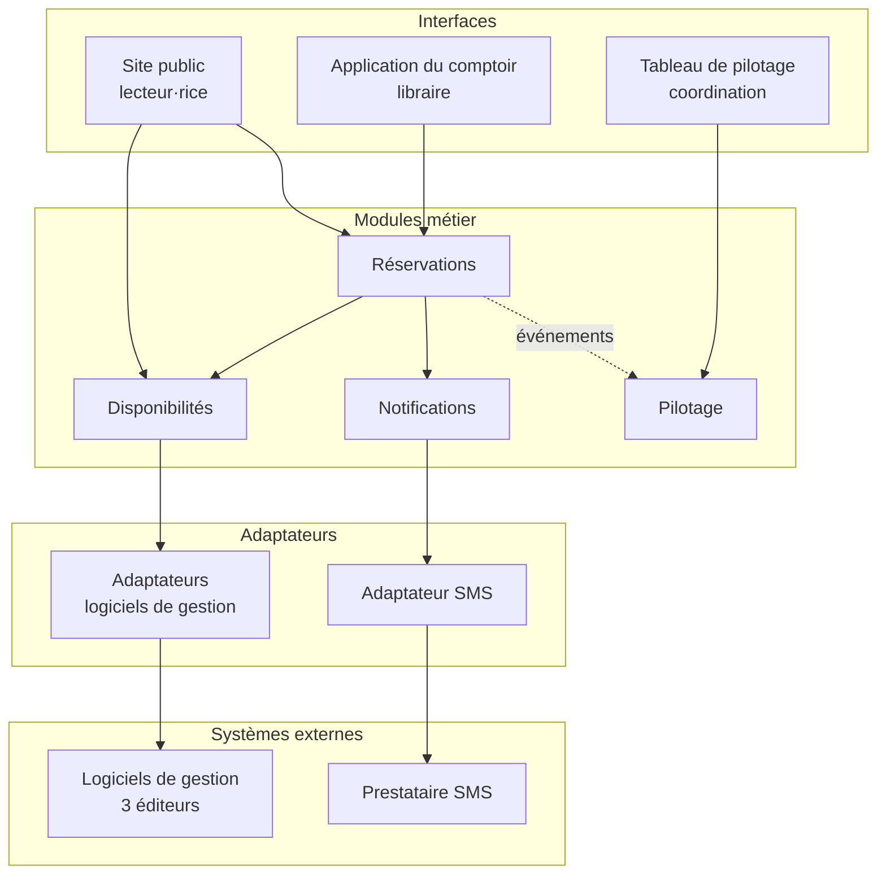
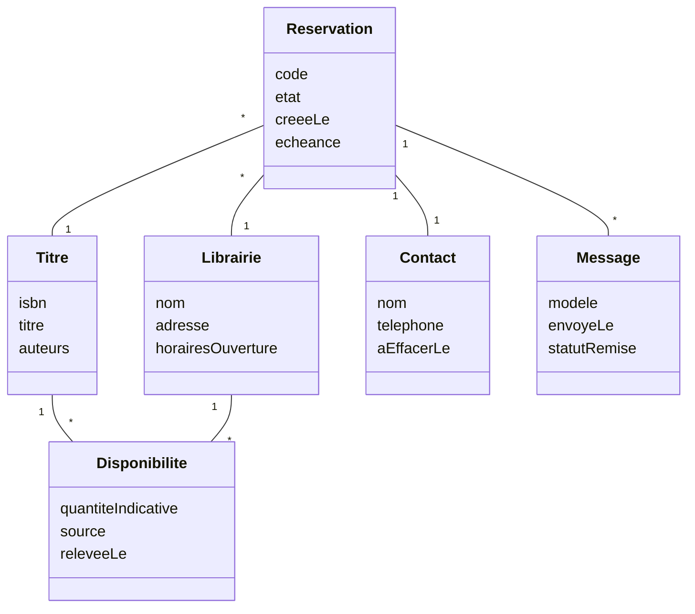
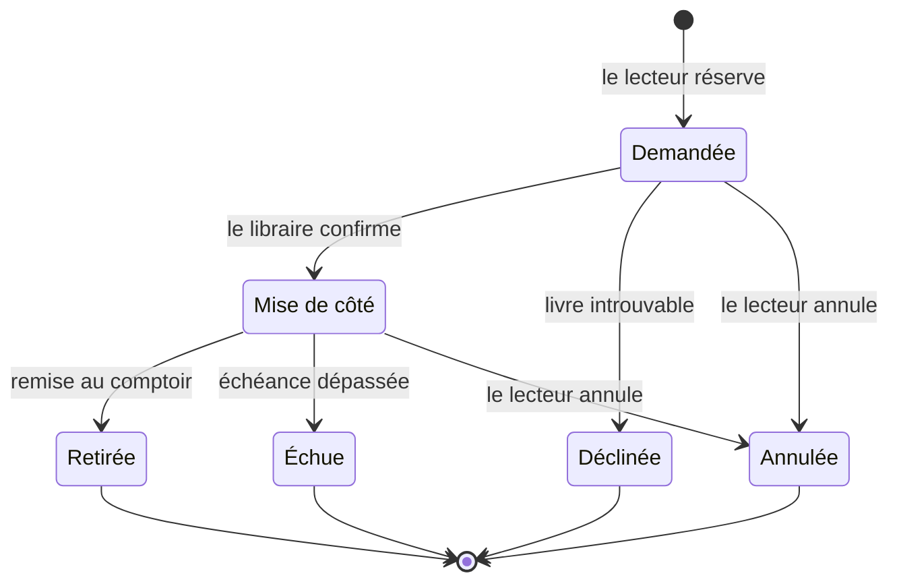
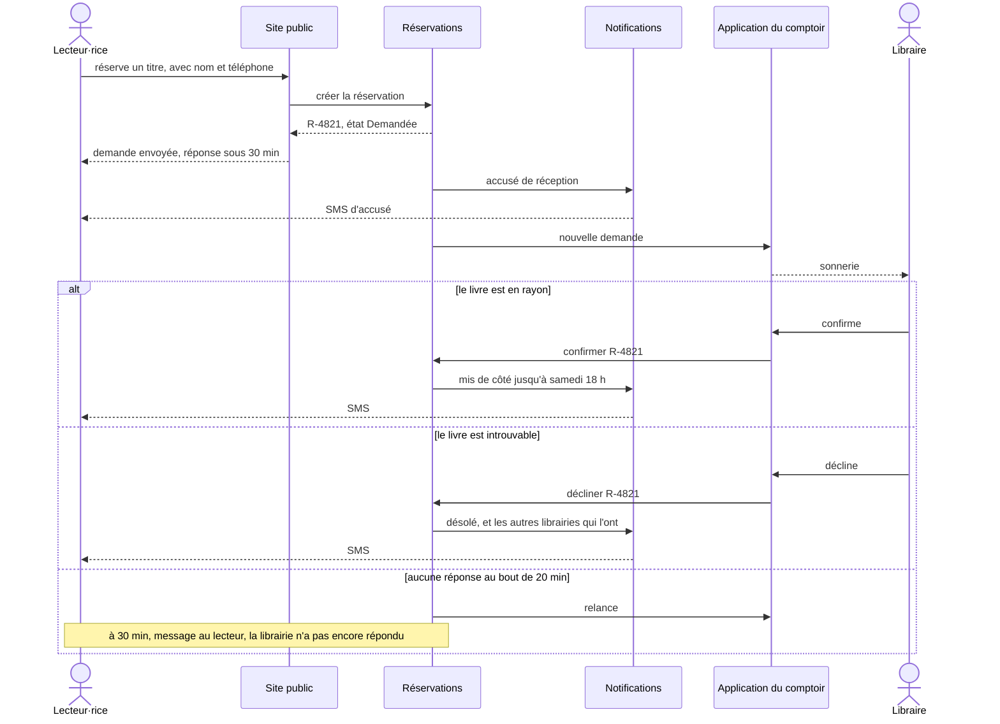

[← Chapitre précédent](02-J1-Atelier-Cartographier-le-service.md) · [Sommaire](Readme.md) · [Chapitre suivant →](04-J2-Atelier-Concevoir-et-soutenir.md)

# Jour 2 · Cours — Du blueprint à l'application

> **Jour 2, matin — 1 h 30.** Juste après la pause, et tout l'après-midi, vous appliquerez cette démarche au blueprint de votre équipe dans l'[atelier « Concevoir et soutenir »](04-J2-Atelier-Concevoir-et-soutenir.md).

## 🎯 Objectifs

À la fin de ce cours, vous saurez :

1. Lire un blueprint comme une spécification : en tirer acteurs, interfaces, règles, intégrations et exigences.
2. Passer des parties prenantes aux acteurs, puis aux cas d'utilisation et aux capacités du système.
3. Découper une application en modules alignés sur les capacités du service.
4. Identifier les objets du domaine, et décrire le cycle de vie de l'objet central.
5. Détailler un moment de vérité en diagramme de séquence, chemins d'erreur compris.
6. Transformer les engagements du service en niveaux de service mesurables et en exigences non fonctionnelles.
7. Tester un service avant de le coder.

## Déroulé

| Horaire | Séquence | Durée |
|---|---|---|
| 09:00 | Rappel de la veille | 10 min |
| 09:10 | 1. Ce que le blueprint dit au concepteur · 2. Acteurs, cas d'utilisation, capacités, avec l'exercice 1 | 25 min |
| 09:35 | 3. Découper par capacités · 4. Le domaine et le cycle de vie | 20 min |
| 09:55 | 5. Un moment de vérité en séquence | 10 min |
| 10:05 | 6. Des engagements aux niveaux de service, avec l'exercice 2 · 7. Tester le service avant de le coder | 25 min |

## Rappel de la veille

Cinq questions, à main levée :

1. Pourquoi dit-on que l'usager co-produit un service ? Donnez un exemple chez Lucioles.
2. Quelle est la différence entre un canal et un point de contact ?
3. Que sépare la ligne de visibilité ? Et la ligne d'interaction interne ?
4. Pourquoi un blueprint ne suit-il qu'un seul scénario ?
5. Citez un engagement de Lucioles, et le débat de conception qu'il tranche.

Voir les réponses

1. Parce que le service ne peut être rendu sans sa participation : le lecteur saisit son téléphone, se déplace, donne son code. S'il se trompe de numéro, le service ne peut plus le prévenir — c'est au service de l'avoir prévu.
2. Le canal est le moyen de communication — site, SMS, comptoir. Le point de contact est une occasion précise d'interaction sur ce canal — le SMS « mis de côté », l'étiquette sur le livre.
3. La ligne de visibilité sépare ce que l'usager voit de ce qu'il ne voit pas. La ligne d'interaction interne sépare ceux qui sont au contact, ou travaillent directement pour eux, des fonctions et des systèmes qui les soutiennent.
4. Parce qu'un blueprint qui mélange plusieurs chemins se remplit de « ou », et on n'y voit plus les passages de relais. Un incident majeur mérite son propre blueprint.
5. Par exemple E2, « Quand on vous dit que c'est prêt, c'est prêt » : il interdit d'envoyer le SMS « prêt » avant que le libraire ait vérifié le rayon, même si ce serait plus rapide.

---

## 1. Ce que le blueprint dit au concepteur

Hier, le blueprint servait à comprendre le service. Aujourd'hui, il sert de **spécification** : chaque couloir, chaque ligne et chaque repère se traduit en un élément de conception.

| Dans le blueprint | Dans la conception | Chez Lucioles |
|---|---|---|
| Actions de l'usager | cas d'utilisation, user stories, écrans | « Réserver un titre » |
| Frontstage numérique | interfaces : écrans, notifications, contenus | le SMS « mis de côté », sa formulation, son lien de suivi |
| Frontstage humain | outils du personnel | l'application du comptoir, la recherche par code |
| Backstage | processus, règles de gestion, cycle de vie des objets | confirmer ou décliner ; échéance ; remise en rayon |
| Processus support | modules, intégrations, API, données de référence | adaptateurs vers les logiciels de gestion ; prestataire SMS |
| Flèches qui traversent une ligne | contrats d'interface ; droits d'accès | qui voit le téléphone du lecteur, et qui ne le voit pas |
| Ruptures ⚠ F et attentes ⌛ A | cas d'erreur, plans de secours, relances, exigences de délai | relance du comptoir à 20 min ; message honnête au lecteur à 30 min |
| Engagements de la promesse | niveaux de service mesurables | E1 → 90 % des réservations traitées en moins de 30 min |

Deux phrases à garder en tête :

- **Le frontstage humain est le grand oublié des cahiers des charges.** Chaque personne qui rend le service a besoin d'un outil, et cet outil est une interface à concevoir avec le même soin que celle de l'usager. Le libraire confirme une réservation entre deux clients, debout, d'une main : son écran doit le permettre.
- **Chaque flèche qui traverse une ligne pose une question.** La ligne d'interaction interne : quel contrat d'interface ? La ligne de visibilité : qui voit quoi ? C'est là que naissent la plupart des exigences de sécurité.

---

## 2. Acteurs, cas d'utilisation, capacités

### 2.1 Des parties prenantes aux acteurs

Un **acteur** est un rôle, humain ou système, qui interagit **directement** avec le système à construire. Toutes les parties prenantes ne sont pas des acteurs : la carte de l'écosystème est plus large que le diagramme de cas d'utilisation, et c'est normal.

| Partie prenante | Acteur ? | Pourquoi |
|---|---|---|
| Lecteur·rice | oui, principal | cherche, réserve, suit sa réservation |
| Libraire | oui, principal | confirme, décline, remet, réserve pour un client au téléphone |
| Coordinatrice | oui, principal | suit l'activité du réseau |
| Logiciel de gestion d'une librairie | oui, secondaire | fournit l'état du stock |
| Prestataire SMS | oui, secondaire | achemine les messages |
| Distributeurs | non | ils livrent les librairies, sans jamais toucher au système |
| Agglomération | non | elle reçoit un bilan, produit par la coordinatrice |
| CNIL | non | elle encadre le traitement : elle produit des exigences, pas des interactions |

Le lecteur qui **téléphone** à sa librairie n'est pas un acteur du système, à ce moment-là : c'est le libraire qui agit pour lui. D'où un cas d'utilisation à part, « Réserver pour un client au téléphone », qui rend le service omnicanal.

### 2.2 Le diagramme de cas d'utilisation

Les cas d'utilisation se lisent directement dans les couloirs du blueprint : les actions de l'usager pour le lecteur, le backstage pour le libraire, les processus support pour les acteurs systèmes.

Ce schéma imite un diagramme de cas d'utilisation avec Mermaid, que GitHub affiche directement. Pour un vrai diagramme UML, avec ses relations d'inclusion, PlantUML convient bien :

« Synchroniser les stocks » n'est déclenché par aucun humain : c'est le **temps** qui le déclenche, toutes les quinze minutes pour les librairies qui ont une API, chaque nuit pour les autres. Ce genre de cas d'utilisation n'apparaît dans aucun écran, et c'est le blueprint qui le fait découvrir.

### 2.3 Des cas d'utilisation aux capacités

Une **capacité** est ce que le service doit être capable de faire, indépendamment de qui le fait et de comment : « dire qui a quoi », « gérer les réservations », « prévenir », « mesurer ». Regrouper les cas d'utilisation par capacité prépare le découpage en modules.

| Capacité | Cas d'utilisation | Couloir d'origine |
|---|---|---|
| Connaître les disponibilités | rechercher un titre ; synchroniser les stocks | processus support |
| Gérer les réservations | réserver ; suivre ou annuler ; confirmer ou décliner ; réserver pour un client ; remettre ; remettre en rayon | actions de l'usager, backstage |
| Prévenir | envoyer une notification | frontstage numérique, processus support |
| Piloter | consulter les indicateurs | l'« après » du parcours |

### Exercice 1 — Les acteurs de la cantine (5 min)

Reprenez le blueprint de l'absence, corrigé hier dans l'exercice 3.

1. Listez les acteurs du système, en distinguant acteurs principaux et acteurs systèmes.
2. Nommez trois cas d'utilisation.
3. Citez une partie prenante qui n'est **pas** un acteur, et dites pourquoi.

Voir la correction

1. **Acteurs principaux** : le parent ; l'animateur·rice, qui consulte la liste de pointage et pointe ; le directeur ou la directrice d'école, qui consulte les absences du jour ; l'agent du service scolaire, qui saisit une absence signalée par téléphone. **Acteurs systèmes** : le système du prestataire, qui reçoit les quantités ; la facturation.
2. « Signaler une absence » ; « Consulter la liste de pointage du jour » ; « Transmettre les quantités au prestataire ». On peut ajouter « Saisir une absence signalée par téléphone », qui rend le service omnicanal.
3. **L'enfant** : il est au centre du service — c'est lui qui mange —, mais il n'interagit jamais avec le système. Ou encore le médecin qui établit un PAI : il produit une information, mais par l'intermédiaire de la famille et de l'école.

---

## 3. Découper par capacités

### 3.1 Trois découpages qui ne tiennent pas

- **Par écran** : un module « recherche », un module « formulaire », un module « suivi ». Chaque écran réimplémente les règles des autres, et la règle d'échéance finit écrite en trois endroits, de trois façons.
- **Par couche technique seulement** : présentation, logique, données. C'est nécessaire, mais insuffisant : cela ne dit rien du métier, et tout le métier finit dans une seule couche géante.
- **Par organigramme** : la **loi de Conway**, formulée en 1968, observe que les organisations conçoivent des systèmes qui reproduisent leurs structures de communication. Le blueprint montre l'organisation : cinq librairies, une coordination. Ce n'est pas une raison pour faire cinq modules.

### 3.2 Découper par capacité métier

Un module correspond à **une capacité**. Il est responsable de **ses données** et parle **son vocabulaire** : c'est l'idée des contextes délimités (*bounded contexts*) du *Domain-Driven Design* d'Eric Evans. Dans le module Réservations, une réservation a un état et une échéance ; dans le module Disponibilités, il n'y a pas de réservation, seulement des quantités indicatives et la date à laquelle on les a relevées.

Pour une application organisée en couches, cela donne, chez Lucioles :

| Module | Capacité | Données dont il est responsable | Échange avec |
|---|---|---|---|
| Disponibilités | dire quelle librairie a quel titre, et depuis quand on le sait | titres, disponibilités | logiciels de gestion, par des adaptateurs : un par éditeur |
| Réservations | prendre, suivre et clore une réservation | réservations, contacts | Disponibilités, Notifications ; publie ses événements pour le Pilotage |
| Notifications | prévenir la bonne personne, au bon moment, sur le bon canal | messages, accusés de remise | prestataire SMS, par un adaptateur |
| Pilotage | mesurer le service | indicateurs agrégés, sans données personnelles | événements des Réservations |

Les **adaptateurs** isolent le métier des systèmes externes : le jour où une librairie change de logiciel de gestion, on écrit un adaptateur, et rien d'autre ne bouge. C'est la traduction directe de la ligne d'interaction interne du blueprint.

### 3.3 Un module n'est pas un microservice

Pour un service de cette taille, une **seule application déployable, organisée en modules bien séparés** — on parle de monolithe modulaire — est presque toujours le bon choix. Les modules s'appellent par des interfaces explicites, et aucun ne lit directement les tables d'un autre. Les microservices ajoutent le réseau, le déploiement et la cohérence des données entre services : un coût qui se justifie par l'échelle ou par le nombre d'équipes, pas par cinq librairies. Découper par capacités prépare l'avenir sans le payer d'avance.

---

## 4. Le domaine et le cycle de vie

### 4.1 Les objets du domaine

Les objets du domaine se lisent dans les annotations **D** du blueprint et dans les noms qui reviennent d'un couloir à l'autre : titre, librairie, disponibilité, réservation, contact, message. Les noms sont écrits ici comme dans le code, sans accents.

Trois décisions de conception que le blueprint a imposées :

- **Un titre, pas un exemplaire.** Lucioles ne connaît pas les exemplaires : ce sont les logiciels de gestion qui les suivent. On réserve un titre dans une librairie, et c'est le libraire qui choisit l'exemplaire. C'est pour cela que le backstage comporte « vérifier le rayon ».
- **Une disponibilité datée.** Le stock affiché porte l'heure à laquelle on l'a relevé et sa source, API ou export nocturne : c'est la réponse à la rupture F1.
- **Un contact séparé de la réservation.** Le nom et le téléphone vivent dans un objet à part, effacé trente jours après la clôture : l'engagement E4 devient une structure de données. On garde la réservation, anonymisée, pour les indicateurs.

Ce modèle est le point de départ de votre **modèle conceptuel de données** : c'est là que commence la compétence *Concevoir et mettre en place une base de données relationnelle*.

### 4.2 Le cycle de vie de l'objet central

L'objet central d'un service est celui qui traverse tout le blueprint. Chez Lucioles, c'est la réservation.

Ce diagramme est un concentré du service :

- **Chaque état est quelque chose que l'usager doit pouvoir voir** : la page de suivi affiche l'état, en mots simples. C'est la réponse à l'intangibilité du service.
- **Chaque transition a un auteur, une règle et, souvent, un message.** « Le libraire confirme » envoie le SMS « mis de côté » ; « échéance dépassée » suppose une règle — cinq jours, ou le samedi suivant ? — et un rappel la veille.
- **Une attente du blueprint devient une minuterie.** L'attente A1 n'est pas un état : c'est un délai à l'intérieur de l'état « Demandée », qui déclenche une relance à 20 minutes, puis un message au lecteur à 30 minutes.
- **Chaque état final déclenche l'effacement** du contact, trente jours plus tard.

---

## 5. Un moment de vérité en séquence

Le diagramme de séquence détaille, message par message, ce qui se passe pendant un moment de vérité. Voici MV2, la confirmation de la mise de côté.

Quatre règles pour dessiner une séquence utile :

- **Dessinez les chemins d'erreur d'abord.** Le chemin nominal est facile ; c'est dans les branches `alt` que se trouve la conception.
- **Chaque flèche entre deux modules est une interface** : appel synchrone, ou événement ? La flèche « nouvelle demande » vers le comptoir est poussée. Et si la tablette est hors ligne ? L'application du comptoir doit récupérer les demandes en attente à la reconnexion.
- **Pensez à l'idempotence.** Le libraire appuie deux fois sur « confirmer » : le lecteur ne doit recevoir qu'un SMS.
- **Les minuteries sont des composants.** La relance à 20 minutes et le message à 30 minutes supposent un ordonnanceur. Il n'existe que parce que le blueprint contenait une attente.

---

## 6. Des engagements aux niveaux de service

### 6.1 Trois sigles

Le vocabulaire vient de l'ingénierie de la fiabilité des sites, popularisée par Google :

| Sigle | En français | Ce que c'est | Exemple |
|---|---|---|---|
| **SLI** | indicateur de niveau de service | une mesure, le plus souvent un ratio : événements réussis / événements valides | part des réservations traitées en moins de 30 min |
| **SLO** | objectif de niveau de service | la cible fixée pour un indicateur, sur une période | 90 %, sur quatre semaines glissantes |
| **SLA** | accord de niveau de service | un **contrat** entre deux organisations, avec des conséquences s'il n'est pas tenu | « au-delà de 5 jours ouvrés, pénalité de… » |

Un SLO n'est **jamais 100 %**. Viser 100 % est hors d'atteinte et fige tout : chaque changement devient un risque. L'écart entre l'objectif et la perfection — le **budget d'erreur** — est la marge qui permet d'évoluer et d'absorber les incidents.

### 6.2 Du principe au chiffre

| Engagement | Indicateur (SLI) | Objectif (SLO) | Ce que cela implique pour la conception |
|---|---|---|---|
| E1 — réponse en moins de 30 min | part des réservations confirmées ou déclinées moins de 30 min après leur création, comptées en heures d'ouverture | 90 % sur quatre semaines glissantes | horodater chaque transition ; notification poussée au comptoir ; relance à 20 min ; horaires d'ouverture de chaque librairie dans les données |
| E2 — prêt, c'est prêt | part des réservations mises de côté remises sans incident | 98 % sur quatre semaines | confirmation humaine obligatoire avant le SMS ; motif saisi au comptoir quand le livre n'est pas retrouvé |
| E3 — en main en 2 min | durée entre la présentation du code et la remise du livre | médiane sous 2 min, mesurée par observation une semaine par trimestre | recherche par code au comptoir ; étagère rangée par code |
| *(moyen technique)* | part des minutes, en heures d'ouverture, où recherche et réservation répondent en moins de 2 s | 99,5 % par mois | supervision ; mode dégradé : si la recherche tombe, afficher le téléphone des librairies |

Trois remarques :

- **E3 se mesure par observation.** Un niveau de service n'est pas toujours calculable par l'application, et ce n'est pas une raison pour y renoncer.
- **La disponibilité technique n'est pas un engagement de l'usager** : c'est un moyen au service de E1 et E2. Elle est nécessaire, pas suffisante.
- **E4 n'est pas un SLO** : effacer les données à trente jours n'admet pas de budget d'erreur. C'est une **exigence**, vérifiée par des tests et par un audit.

### 6.3 Les autres exigences non fonctionnelles

Chaque exigence non fonctionnelle a une **origine** dans le blueprint. Dites-la : c'est ce qui la rend défendable.

| Exigence | Son origine dans le blueprint | Chez Lucioles |
|---|---|---|
| Sécurité et droits d'accès | les flèches qui traversent la ligne de visibilité et la ligne d'interaction interne | un libraire ne voit que les réservations de sa librairie ; le lien de suivi n'est pas devinable ; l'étiquette porte un code, pas un nom |
| Protection des données personnelles | les annotations **D** | deux données seulement, nom et téléphone ; effacement à trente jours ; aucun historique de lecture par personne : ce qu'on lit en dit long sur soi |
| Accessibilité | les preuves physiques et le frontstage numérique | site conçu selon le RGAA ; SMS compréhensible sans ouvrir le lien. Selon sa nature et sa taille, un service peut y être légalement tenu, notamment depuis l'entrée en application de la directive européenne sur l'accessibilité, en juin 2025 |
| Robustesse et mode dégradé | les ruptures **F** | stock indisponible : afficher « à vérifier par téléphone » ; SMS en échec : statut visible au comptoir |
| Sobriété | le blueprint entier | un SMS plutôt qu'une application à installer ; ne synchroniser que ce qui change ; le référentiel général d'écoconception de services numériques (RGESN) comme liste de contrôle |

### Exercice 2 — Les niveaux de service de la cantine (8 min)

Deux engagements de la cantine :

- « Une absence signalée avant 10 h n'est pas facturée, quel que soit le canal utilisé pour la signaler. »
- « L'animateur·rice dispose, avant 11 h 30, d'une liste de pointage à jour. »

Pour chacun, proposez un **indicateur**, un **objectif**, et **une** conséquence pour la conception.

Voir la correction

| Engagement | Indicateur (SLI) | Objectif (SLO) | Conséquence pour la conception |
|---|---|---|---|
| Absence non facturée | part des absences signalées avant 10 h, tous canaux confondus, absentes de la facture | 99 % par mois, chaque écart étant corrigé d'office sur la facture suivante | l'accueil téléphonique saisit les absences dans le même outil que les parents ; chaque signalement est horodaté avec son canal ; la facture se calcule à partir des absences |
| Liste à jour avant 11 h 30 | part des jours d'école où la liste de chaque école est disponible et à jour à 11 h 30 | 98 % des jours-écoles par trimestre | liste produite automatiquement à 11 h ; une absence signalée après 11 h est mise en évidence ; mode dégradé si l'impression ou le réseau tombe |

La première ligne montre une nuance utile : quand un écart a des conséquences pour l'usager — ici, une facture fausse —, l'objectif s'accompagne d'une **procédure de correction**. Le budget d'erreur ne dispense pas de réparer.

---

## 7. Tester le service avant de le coder

Un service se teste avant d'écrire la moindre ligne de code. Trois techniques, de la moins chère à la plus réaliste :

| Technique | Comment | Ce qu'elle teste | Coût |
|---|---|---|---|
| **Marche à blanc** (*desktop walkthrough*) | sur le blueprint ou une maquette de table, une personne joue l'usager, les autres jouent le personnel et les systèmes ; on déroule le scénario à voix haute, étape par étape | qui fait quoi, avec quelle information, à quel moment ; les trous du blueprint | quinze minutes |
| **Magicien d'Oz** (*Wizard of Oz*) | l'usager croit le service automatisé, mais un humain le fait en coulisses : pendant un essai, la coordinatrice envoie les SMS à la main | la promesse elle-même, avant d'automatiser quoi que ce soit | quelques jours |
| **Pilote** | le service réel, en petit : une librairie, un mois, de vrais lecteurs, des indicateurs mesurés | tout, en conditions réelles | quelques semaines |

Pendant une marche à blanc, posez sans cesse trois questions : « Qui fait ça ? », « Comment le sait-il ? », « Et si ça ne marche pas ? ». Vous trouverez des tâches sans propriétaire, des informations qui arrivent trop tard, et des règles que personne n'avait décidées. Chacune, trouvée sur la table, vous épargne un ticket d'anomalie en production.

> Le meilleur prototype d'un service, c'est le service lui-même, en petit.

---

## 📁 Dossier de projet

Pour la compétence *Définir l'architecture logicielle d'une application*, le jury attend que vous justifiiez vos choix. Montrez la **traçabilité** du besoin à l'architecture, avec la matrice [B.7](B-Modeles-et-canevas.md) :

| Étape du blueprint | Cas d'utilisation | Module | Données | Niveau de service |
|---|---|---|---|---|
| 3. Être prévenu | Confirmer ou décliner une réservation | Réservations, Notifications | Reservation, Message | E1 : 90 % en moins de 30 min |

Ajoutez le **diagramme de séquence d'un moment de vérité**, chemins d'erreur compris, et vos **exigences non fonctionnelles avec leur origine**. À la question « Pourquoi ce module ? », la meilleure réponse commence par : « Parce que dans le blueprint… ».

## Ce qu'il faut retenir

- Chaque couloir du blueprint devient un élément de conception ; le frontstage humain devient un outil à part entière.
- Toutes les parties prenantes ne sont pas des acteurs ; certains cas d'utilisation ne sont déclenchés que par le temps.
- On découpe par capacités métier, pas par écran, par couche ou par organigramme ; un module n'est pas un microservice.
- Le cycle de vie de l'objet central montre ce que l'usager doit pouvoir suivre, et où sont les règles.
- Un moment de vérité se dessine en séquence, chemins d'erreur d'abord.
- Les engagements deviennent des SLI et des SLO ; ce que le logiciel ne mesure pas se mesure autrement.
- On teste un service sur la table avant de le coder.

## Pour aller plus loin

- Google, *Site Reliability Engineering*, chapitre [*Service Level Objectives*](https://sre.google/sre-book/service-level-objectives/) — les SLI, SLO et SLA, en anglais.
- Martin Fowler, [*Bounded Context*](https://martinfowler.com/bliki/BoundedContext.html) et [*Conway's Law*](https://martinfowler.com/bliki/ConwaysLaw.html) — deux articles courts, en anglais.
- Eric Evans, *Domain-Driven Design: Tackling Complexity in the Heart of Software*, 2003 — l'ouvrage de référence sur les contextes délimités.
- CNIL, [*Guide RGPD du développeur*](https://www.cnil.fr/fr/guide-rgpd-du-developpeur) — la protection des données dès la conception, fiche par fiche.
- [Référentiel général d'écoconception de services numériques](https://ecoresponsable.numerique.gouv.fr/publications/referentiel-general-ecoconception/) (RGESN).
- PlantUML, [diagrammes de cas d'utilisation](https://plantuml.com/fr/use-case-diagram).

---

[← Chapitre précédent](02-J1-Atelier-Cartographier-le-service.md) · [Sommaire](Readme.md) · [Chapitre suivant →](04-J2-Atelier-Concevoir-et-soutenir.md)
