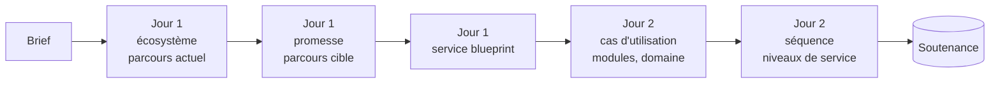

  <picture>
    <source media="(prefers-color-scheme: dark)" srcset="assets/Logo-diginamic-color-blk.png">
    
  </picture>

# Conception et design de service

Un jour et demi pour apprendre à concevoir **un service**, et pas seulement une application : comprendre l'écosystème dans lequel il s'inscrit, dessiner le parcours de ses usager·e·s sur tous les canaux, rendre visibles les coulisses qui le font fonctionner, puis en tirer la conception de l'application qui en réalisera une partie. Le cours alterne **apports théoriques** et **atelier en équipe** sur un fil rouge, et se termine par une **soutenance** devant le groupe.

Le cours s'adresse à des concepteur·rice·s développeur·se·s d'applications, pas à des designers : il ne fait pas de vous des designers de service en un jour et demi. Il vous donne de quoi vous poser, avant d'écrire la première ligne de code, la question que les clients ne posent jamais : **qu'est-ce qui doit se passer, et pour qui, pour que ce service soit vraiment rendu ?** Et il vous apprend à transformer la réponse en architecture.

## 🎯 Objectifs pédagogiques

À la fin de ce jour et demi, vous saurez :

1. Expliquer ce qu'est un service, ce qui le distingue d'un produit, et pourquoi une application n'en est presque toujours qu'une partie.
2. Situer le design de service par rapport à l'UX, à l'UI et à la conception logicielle, et en appliquer les principes.
3. Cartographier l'écosystème d'un service : parties prenantes, flux échangés, systèmes d'information existants.
4. Formuler la promesse d'un service et la traduire en engagements vérifiables.
5. Concevoir un parcours usager cible sur plusieurs canaux et en identifier les moments de vérité.
6. Construire un service blueprint, de ce que voit l'usager jusqu'aux processus support, y repérer les points de rupture et le tester par une marche à blanc.
7. Tirer d'un blueprint les éléments de conception d'une application : acteurs, cas d'utilisation, modules, objets du domaine et leur cycle de vie, séquences d'interaction.
8. Transformer les engagements du service en niveaux de service mesurables et en exigences non fonctionnelles : sécurité, données personnelles, accessibilité, sobriété.

## ❔ Pourquoi ce cours ?

Une application peut être parfaitement codée et le service qu'elle sert, raté. Le formulaire de réservation fonctionne, mais personne ne voit la réservation arriver au comptoir. Le signalement est bien enregistré, mais l'habitant n'apprend jamais que le problème est réglé. L'alternant a un compte sur la plateforme, mais il le reçoit trois jours après la rentrée. Dans chacun de ces cas, le défaut n'est pas dans l'écran : il est **dans les coulisses**, entre deux personnes, deux outils ou deux organisations.

Le design de service sert à voir ces coulisses **avant** de concevoir. Pour un·e concepteur·rice développeur·se, c'est aussi la meilleure source d'exigences qui soit : chaque échange entre deux acteurs est une interface à concevoir, chaque attente est une exigence de performance, chaque point de rupture est un cas d'erreur à traiter, chaque promesse faite à l'usager est un niveau de service à mesurer.

**Au regard du titre professionnel Concepteur développeur d'applications (RNCP37873)**, ce module travaille directement des compétences évaluées :

| Bloc | Compétence | Ce que le module y apporte |
|---|---|---|
| BC02 — Concevoir et développer une application sécurisée organisée en couches | Analyser les besoins et maquetter une application | écosystème, parcours cible, service blueprint, cas d'utilisation |
| BC02 — Concevoir et développer une application sécurisée organisée en couches | Définir l'architecture logicielle d'une application | découpage en modules, domaine, séquences, exigences non fonctionnelles |
| BC01 — Développer une application sécurisée | Contribuer à la gestion d'un projet informatique | travail en équipe, cadrage avec un commanditaire, priorisation, restitution |

Le modèle du domaine construit au deuxième jour prépare aussi la compétence *Concevoir et mettre en place une base de données relationnelle* : c'est le point de départ de votre modèle conceptuel de données.

À l'examen, ces compétences sont évaluées à partir du **dossier de projet**, de sa **présentation au jury** et d'un **entretien technique**. Le jury vous demandera **pourquoi** votre application est conçue ainsi : le blueprint et la traçabilité entre le besoin et l'architecture sont votre réponse. Les sections 📁 *Dossier de projet* des chapitres de cours disent quoi en reprendre. Le glossaire de l'[annexe C](C-Glossaire-et-ressources.md) donne les équivalents anglais de tout le vocabulaire, utiles pour le questionnaire sur une documentation technique en anglais et pour la littérature du domaine, largement anglophone.

## Public et prérequis

- Apprenant·e·s du titre **Concepteur développeur d'applications** (CDA).
- Notions de base d'UML : savoir lire un diagramme de cas d'utilisation, de classes et de séquence. Le cours les rappelle au moment où il s'en sert.
- Si vous avez déjà construit des personas, des parcours ou des user stories, par exemple dans un module d'UX, ils vous serviront. Sinon, le cours rappelle l'essentiel.
- Aucune compétence graphique n'est requise : on dessine des boîtes et des flèches.
- Un ordinateur portable avec un navigateur récent.

## Organisation du jour et demi

### Le déroulé

| Quand | Horaire | Séquence |
|---|---|---|
| **Jour 1** | 09:00 – 09:20 | Ouverture : tour de table, présentation du module et du fil rouge |
| | 09:20 – 10:30 | Cours 1, première partie |
| | 10:30 – 10:45 | Pause |
| | 10:45 – 12:30 | Cours 1, seconde partie, avec exercices |
| | 12:30 – 13:30 | Déjeuner |
| | 13:30 – 16:15 | Atelier, partie 1, en équipe (pause de 10 minutes incluse) |
| | 16:15 – 17:00 | Restitution : chaque équipe présente, le groupe fait ses retours |
| **Jour 2** | 09:00 – 10:30 | Rappel de la veille, puis cours 2 |
| | 10:30 – 10:45 | Pause |
| | 10:45 – 11:45 | Atelier, partie 2, en équipe |
| | 11:45 – 12:30 | Soutenance finale |

Les horaires sont indicatifs : ce sont les durées qui comptent.

### Les trois demi-journées

| Demi-journée | Cours | Atelier | Ce que l'équipe montre |
|---|---|---|---|
| **Jour 1, matin** | Penser et cartographier un service : service et produit, principes, écosystème, promesse, parcours, moments de vérité, service blueprint | — | — |
| **Jour 1, après-midi** | — | Cartographier le service : écosystème, parcours actuel, promesse et engagements, parcours cible, blueprint | Restitution : la promesse, le blueprint, le point de rupture le plus grave et ce que le service cible en fait |
| **Jour 2, matin** | Du blueprint à l'application : acteurs, cas d'utilisation, modules, domaine, séquences, niveaux de service, marche à blanc | Concevoir l'application du service : marche à blanc, cas d'utilisation, modules, domaine, séquence, niveaux de service | Soutenance : la démarche complète, du brief à l'architecture |

### Le fil rouge

Chaque équipe de trois ou quatre personnes reçoit un **brief** le premier jour ([annexe A](A-Briefs-projets.md)) et le garde jusqu'à la soutenance. Chaque étape de l'atelier part des livrables de la précédente : l'écosystème donne les acteurs du parcours, le parcours cible donne les colonnes du blueprint, les couloirs du blueprint donnent les cas d'utilisation, les modules et les données, les engagements donnent les niveaux de service.

Dans le cours, les exemples portent sur un autre service, **Lucioles**, le réseau de cinq librairies indépendantes d'une agglomération, qui veut permettre de réserver un livre en ligne et de le retirer en librairie. Les exercices portent sur un troisième sujet, la **restauration scolaire** d'une commune. On vous montre la démarche sur Lucioles, vous vous exercez sur la cantine, vous l'appliquez à votre brief.

## Le parcours

Chaque séquence est un fichier. On les suit **dans l'ordre** : chaque atelier s'appuie sur le cours qui le précède et sur les livrables de l'étape d'avant.

| # | Séquence | Quand | Durée | Ce qu'on y fait |
|---|---|---|---|---|
| [01](01-J1-Cours-Penser-et-cartographier-un-service.md) | Penser et cartographier un service | J1 matin | 3 h 15 | service et produit, design de service, écosystème, promesse et engagements, parcours cible, moments de vérité, service blueprint |
| [02](02-J1-Atelier-Cartographier-le-service.md) | Atelier, partie 1 : cartographier le service | J1 après-midi | 2 h 45 + 45 min | brief et commanditaire, écosystème, parcours actuel, promesse, parcours cible, blueprint, restitution |
| [03](03-J2-Cours-Du-blueprint-a-l-application.md) | Du blueprint à l'application | J2 matin | 1 h 30 | lire un blueprint en concepteur, cas d'utilisation, modules, domaine, séquences, niveaux de service, marche à blanc |
| [04](04-J2-Atelier-Concevoir-et-soutenir.md) | Atelier, partie 2 : concevoir et soutenir | J2 matin | 1 h + 45 min | marche à blanc, cas d'utilisation et modules, domaine, séquence d'un moment de vérité, niveaux de service, soutenance |
| [A](A-Briefs-projets.md) | Briefs projets | J1 → J2 | — | les quatre services du fil rouge |
| [B](B-Modeles-et-canevas.md) | Modèles et canevas | J1 → J2 | — | gabarits d'écosystème, de parcours, de blueprint, de niveaux de service, grilles de retours et d'évaluation |
| [C](C-Glossaire-et-ressources.md) | Glossaire et ressources | — | — | vocabulaire français / anglais, références, outils |

## Outils et matériel

| Besoin | Outil conseillé | Alternative |
|---|---|---|
| Cartographies : écosystème, parcours, blueprint | grandes feuilles ou un mur, post-its de cinq couleurs, ruban adhésif pour tracer les lignes du blueprint | un tableau blanc partagé : Miro, FigJam, ou [Excalidraw](https://excalidraw.com) sans compte |
| Marche à blanc | le blueprint affiché, des figurines ou des carrés de papier, un plan sommaire des lieux | le blueprint partagé à l'écran |
| Diagrammes UML | [Mermaid](https://mermaid.js.org/), rendu directement par GitHub | [PlantUML](https://plantuml.com/fr/), [draw.io](https://app.diagrams.net/) |
| Dossier de conception | un dépôt Git d'équipe, en Markdown | un document partagé |

**Un espace par équipe, une page par jour.** Chaque équipe ouvre un tableau partagé, ou réserve un mur, avec une page `J1 – Service` et une page `J2 – Conception`, et tient un **journal de conception** ([B.12](B-Modeles-et-canevas.md)) : chaque décision importante, sa raison, la date. Photographiez les supports papier : ils iront dans votre dossier de projet.

## Évaluation

- **En fin de premier jour**, la restitution est formative : elle ne note pas, elle fait progresser. Le groupe et le formateur font leurs retours avec la grille « j'ai aimé / je me demande / je propose » de l'[annexe B](B-Modeles-et-canevas.md).
- **En fin de deuxième jour**, la soutenance est évaluée avec la grille de l'annexe B, construite sur les attendus des compétences visées : prise en compte des besoins de tous les acteurs, cohérence entre le parcours, le blueprint et la conception, traitement des points de rupture, découpage justifié, exigences de sécurité, de protection des données et d'accessibilité, niveaux de service mesurables.

## Pour le formateur

Le dossier `formateur/` contient le [guide d'animation](formateur/Guide-animation.md) : déroulé minuté, consignes, points de vigilance, ce que le commanditaire révèle de chaque brief quand on l'interroge, et repères de correction. Ce fichier n'est pas repris dans le support PDF.
