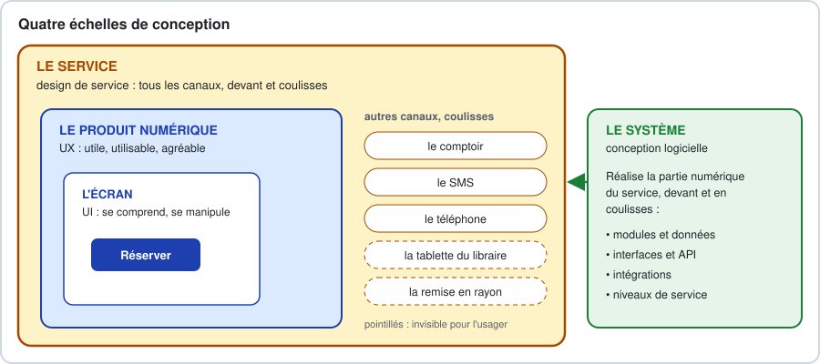
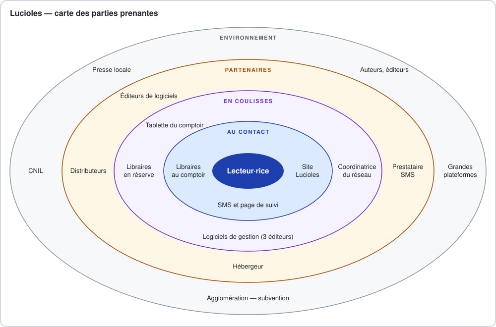
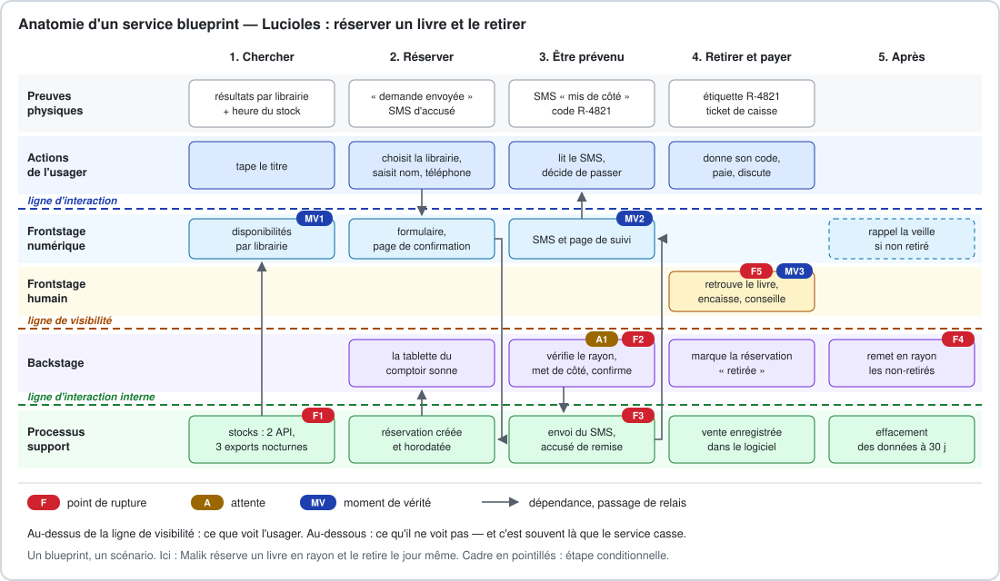
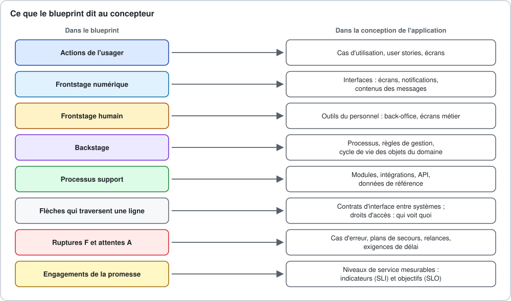

# Conception et design de service

### Du service à l'application

2 jours · Concepteur développeur d'applications

<!-- Diapositive d'ouverture. Avant de commencer : minuteur prêt, post-its de cinq couleurs, ruban adhésif, fiches commanditaire imprimées. Les équipes se composent pendant l'ouverture. -->

---

## 🎯 Objectifs pédagogiques

À la fin de ces deux jours, vous saurez :

1. Expliquer ce qu'est un service, et pourquoi une application n'en est qu'une partie
2. Situer le design de service par rapport à l'UX, à l'UI et à la conception logicielle
3. Cartographier l'écosystème d'un service, systèmes existants compris
4. Formuler une promesse et des engagements vérifiables
5. Concevoir un parcours cible et ses moments de vérité
6. Construire un service blueprint et le tester par une marche à blanc
7. En tirer acteurs, cas d'utilisation, modules, domaine et séquences
8. Traduire les engagements en niveaux de service et en exigences

---

## Les deux jours

| Demi-journée | Cours | Atelier |
|---|---|---|
| **J1 matin** | Penser et cartographier un service | — |
| **J1 après-midi** | — | Cartographier le service, puis restitution |
| **J2 matin** | Du blueprint à l'application | Concevoir l'application : marche à blanc, binômes |
| **J2 après-midi** | — | Concevoir l'application, suite : dossier de conception, puis soutenance |

---

## Le rythme

| Jour 1 | | Jour 2 | |
|---|---|---|---|
| 09:00 | Ouverture | 09:00 – 10:30 | Rappel, puis cours 2 |
| 09:20 – 12:30 | Cours 1, pause à 10:30 | 10:45 – 12:30 | Atelier, partie 2 |
| 13:30 – 16:15 | Atelier, partie 1 | 13:30 – 15:50 | Atelier, partie 2, suite |
| 16:15 – 17:00 | Restitution | 15:50 – 17:00 | Soutenance et bilan |

---

## Trois sujets, trois usages

- **Lucioles** — l'exemple du cours : cinq librairies indépendantes, réserver en ligne, retirer le jour même
- **La cantine** — le sujet des exercices : réservations, absences, facturation
- **Votre brief** — le fil rouge de l'atelier, gardé jusqu'à la soutenance

Premier jour · Ma rue en clair · VéloLongue · À table chez soi

> On vous montre la démarche sur Lucioles, vous vous exercez sur la cantine, vous l'appliquez à votre brief.

---

## Le fil rouge

Brief → **écosystème** → **parcours actuel** → **promesse** → **parcours cible** → **blueprint** → **cas d'utilisation, modules, domaine** → **séquence, niveaux de service** → **soutenance**

Chaque étape part des livrables de la précédente.

---

## Pourquoi ce cours ?

- Une application peut être parfaitement codée… et le service qu'elle sert, raté
- Le défaut n'est pas dans l'écran : il est **dans les coulisses**, entre deux personnes, deux outils, deux organisations
- Le design de service rend ces coulisses visibles **avant** de concevoir

**Au regard du titre CDA :**
- BC02 — *Analyser les besoins et maquetter une application*
- BC02 — *Définir l'architecture logicielle d'une application*
- BC01 — *Contribuer à la gestion d'un projet informatique*

---

# Jour 1

### Penser et cartographier un service

---

## Pour commencer

> Un service qui vous a fait perdre du temps. À quel moment ?

<!-- Tour de table, une phrase par personne. Noter les réponses au tableau : presque toutes se situent en coulisses ou à un changement de canal. Y revenir à la partie 6, sur le blueprint. -->

---

## Lucioles

- Cinq librairies indépendantes, une agglomération de 250 000 habitants
- Aujourd'hui : on appelle les librairies une à une, ou on commande sur une grande plateforme
- Réservations sur carnet ou post-it ; **un livre mis de côté sur six** n'est jamais retiré
- Des clients se déplacent pour un livre vendu entre-temps

**Le projet :** réserver en ligne un livre disponible dans l'une des cinq librairies, et le retirer le jour même.

---

# 1. Qu'est-ce qu'un service ?

---

## Une définition de travail

Une **activité** réalisée **pour** et **avec** un bénéficiaire, pour l'aider à obtenir un résultat, sans transfert de propriété.

- **L'usager co-produit le service** : il saisit son téléphone, se déplace, donne son code. S'il se trompe, c'est au service de l'avoir prévu.
- **Le service est jugé comme un tout** : pour le lecteur, il n'y a pas « le site » et « le back-office ». Il y a Lucioles.

---

## Quatre traits qui compliquent la conception

| Trait | Conséquence pour la conception | Chez Lucioles |
|---|---|---|
| **Intangible** | rendre le service visible : statuts, confirmations | le SMS « mis de côté » |
| **Inséparable** | les erreurs de l'usager sont des cas à prévoir | un numéro mal saisi |
| **Variable** | standardiser, outiller ce qui varie | un samedi de dédicace |
| **Périssable** | gérer capacité, pics, échéances | un livre immobilisé cinq jours |

Une grille discutée, mais une très bonne liste de contrôle.

---

## Le service, l'application et le reste

| Ce que le lecteur voit | Ce qu'il ne voit pas |
|---|---|
| une recherche, des librairies qui ont le livre | cinq logiciels de stock, dont trois mis à jour la nuit |
| un formulaire, un SMS | une tablette qui sonne, un libraire qui vérifie le rayon |
| un livre sur une étagère | une échéance, une remise en rayon, un effacement |

> Le service est jugé à son maillon le plus faible.

---

## Pourquoi c'est votre affaire

Une première version de Lucioles, conçue écran par écran : recherche, formulaire, e-mail à la librairie.

Deux semaines de code, tous les tests passent… **et elle échoue le premier samedi** : personne ne lit sa messagerie au comptoir.

- Les besoins les plus coûteux sont **en coulisses**
- Le référentiel CDA vous demande de concevoir **un système**
- Ce qui n'est pas conçu est **bricolé** : tableur parallèle, double saisie

---

# 2. Le design de service

---

## D'où vient-il ?

- **1982-1984** — G. Lynn Shostack, cadre de banque : le premier **blueprint**, avec sa **ligne de visibilité**
- **1995** — première chaire européenne de design de service, à Cologne ; **début des années 2000**, premières agences, à Londres
- **2010-2018** — *This Is Service Design Thinking*, puis *Doing*
- **En France** — laboratoires d'innovation publique, design des services numériques de l'État

---

## Une définition

> Le design de service conçoit tout ce qui permet à un service d'être rendu : les interactions avec les usager·e·s, sur tous les canaux, et ce qui les rend possibles en coulisses — personnes, processus, outils, règles, partenaires.

Il conçoit **aussi pour ceux qui rendent le service** : le libraire est un usager, lui aussi.

---

## Six principes

| Principe | Ce qu'il change pour vous |
|---|---|
| **Centré sur les humains** | le back-office du libraire est un livrable |
| **Collaboratif** | faire relire le blueprint par ceux qui font le travail |
| **Itératif** | tester le service avant de le coder |
| **Séquentiel** | penser états, délais, relances, fin du parcours |
| **Réel** | mesurer au lieu de supposer |
| **Holistique** | le téléphone et le comptoir existent toujours |

---

## Quatre échelles de conception

Le design de service vérifie que l'application **sert à quelque chose** ; la conception logicielle, qu'elle **tient**.

---

## La démarche

Observer et interroger → **cartographier l'existant** → **définir la promesse** → **concevoir le service cible** → **prototyper et tester** → mettre en œuvre, dont développer → mesurer et ajuster

… et on recommence.

Ce module : la cartographie, la promesse, le service cible, le test sur table, **et le passage à la conception logicielle**.

---

# 3. L'écosystème du service

---

## Les parties prenantes, en cinq cercles

| Cercle | Chez Lucioles |
|---|---|
| **Au centre** | le lecteur ou la lectrice |
| **Au contact** | libraires au comptoir, site, SMS |
| **En coulisses** | libraires en réserve, coordinatrice, logiciels de gestion |
| **Partenaires** | distributeurs, prestataire SMS, hébergeur |
| **Environnement** | agglomération, CNIL, grandes plateformes |

Une partie prenante : qui **agit** sur le service, en est **affecté**, ou peut le **faire échouer**.

---

---

## Les bonnes questions

- Qui **rend** le service, qui le **reçoit**, qui le **paie**, qui le **finance**, qui le **contrôle** ?
- Qui peut le **faire échouer** ? Surtout : qui fait un effort **sans bénéfice** ?
- Qui **gagne** quoi ? Le libraire gagne des ventes ; il doit surveiller une tablette.
- Quels **systèmes** existent déjà ? Comment leur parle-t-on ?

Et ce qui **circule** : informations, données personnelles, argent, objets, décisions.

---

## Le système d'information existant

| Système | Comment on lui parle |
|---|---|
| Logiciel de gestion — trois éditeurs | **2 librairies : API temps réel · 3 librairies : export CSV nocturne** |
| Caisse | intégrée au logiciel de gestion |
| Site vitrine | sans catalogue |
| Prestataire SMS | API HTTP |

> Le stock affiché peut avoir 24 heures de retard : chaque réservation devra être **confirmée par un humain**.

---

## Exercice 1 — L'écosystème de la cantine

**10 minutes, en binôme**

1. Au moins **douze parties prenantes**, dans les cinq cercles
2. **Trois flux**, dont un de données personnelles sensibles
3. Qui peut faire échouer le service **sans en tirer le moindre bénéfice** ?

<!-- Correction collective au tableau, cercle par cercle. Points clés : deux usagers au centre, parent et enfant ; le PAI comme flux de données de santé ; l'animateur qui pointe, effort sans bénéfice. -->

---

# 4. La promesse du service

---

## Ce que l'usager cherche vraiment

| Côté usager | Côté service |
|---|---|
| **Tâches** : trouver un livre précis, vite ; soutenir sa librairie | une recherche commune aux cinq librairies |
| **Problèmes** : appeler cinq librairies ; se déplacer pour rien ; créer un compte | une recherche ; une confirmation humaine ; pas de compte |
| **Bénéfices** : l'avoir aujourd'hui ; le conseil | retrait le jour même ; passage au comptoir |

*Value Proposition Canvas*, Osterwalder et al., 2014

---

## La promesse en une phrase

> Pour **[usager]** qui **[besoin]**, **[service]** permet de **[bénéfice]**, contrairement à **[solution actuelle]**.

Pour les lecteurs qui veulent un livre précis rapidement sans renoncer à leur librairie, **Lucioles** indique en une recherche laquelle des cinq librairies l'a en rayon et le leur met de côté le jour même, sans compte à créer — là où il faut aujourd'hui appeler chaque librairie, ou attendre deux jours une livraison.

---

## Des engagements vérifiables

| # | Engagement |
|---|---|
| E1 | « Vous savez en moins de trente minutes si votre livre vous est mis de côté. » |
| E2 | « Quand on vous dit que c'est prêt, c'est prêt. » |
| E3 | « Au comptoir, votre livre est entre vos mains en moins de deux minutes. » |
| E4 | « Nous ne vous demandons que votre nom et votre téléphone, et nous les effaçons après trente jours. » |

Ils deviendront demain des **niveaux de service**.

---

## Ce qui n'est pas un engagement

- « Offrir une expérience fluide » — invérifiable
- « Le site est développé en React » — pas le point de vue de l'usager
- « Zéro attente » — intenable

> Un engagement est bon s'il tranche un débat. Envoyer le SMS « prêt » dès la réservation ? E2 répond : non.

---

# 5. Le parcours et ses moments de vérité

---

## Du parcours actuel au parcours cible

- **Actuel** : ce qui se passe aujourd'hui, à partir de faits observés → on y cherche les **ruptures**
- **Cible** : ce que le service fera se passer → on supprime les ruptures, sans en créer d'autres
- Trois temps : **avant**, **pendant**, **après**

L'après est presque toujours oublié : rappel, annulation, réclamation, remise en rayon, effacement.

---

## Canaux et points de contact

- **Canal** : site, SMS, téléphone, comptoir, courrier…
- **Point de contact** : la page de résultats, le SMS de confirmation, l'étiquette sur le livre
- **Omnicanal** : changer de canal **sans recommencer**
- **Rupture de canal** : changer de canal fait perdre ou répéter une information

> Le client qui téléphone peut réserver aussi : le libraire saisit la réservation dans le même outil. Décision de service, conséquence dans l'application.

---

## Les moments de vérité

Jan Carlzon, SAS, années 1980 : là où **le service se gagne ou se perd**.

- **Intensité** — inquiet, pressé, soulagé
- **Engagement** — il se déplace, il paie
- **Dépendance** — il ne peut qu'attendre
- **Premier et dernier contact** — la règle du pic et de la fin : la fin compte double

Lucioles : **MV1** la réponse à la recherche · **MV2** la confirmation · **MV3** le comptoir

---

## Le parcours cible de Lucioles

| | Chercher | Réserver | Être prévenu | Retirer | Après |
|---|---|---|---|---|---|
| **Canal** | site | site ou téléphone | SMS | comptoir | SMS |
| **Point de contact** | résultats, heure du stock | formulaire, accusé | « mis de côté » | étagère, ticket | rappel si non retiré |
| **MV** | **MV1** | | **MV2** | **MV3** | |
| **Rupture possible** | stock faux | numéro faux | pas de réponse | livre introuvable | livre immobilisé |

---

## Exercice 2 — Les ruptures de la cantine

**10 minutes, en binôme** — Inès signale l'absence de son fils malade :

portail fermé depuis la veille → répondeur de l'école → e-mail au service scolaire → l'école ne prévient pas la cantine → repas jeté → facturé le mois suivant → certificat à déposer au guichet

1. Les canaux, et chaque changement de canal
2. Les ruptures
3. Le moment de vérité
4. Un engagement pour le service cible

---

# 6. Le service blueprint

---

## Ce que montre un blueprint

- Le parcours montre ce que vit l'usager
- Le **blueprint** montre **ce qui le rend possible** : devant, en coulisses, en support
- Shostack, 1982-1984 ; forme moderne : Bitner, Ostrom et Morgan, 2008

> **Un blueprint, un scénario** : un usager, un objectif, un chemin.

---

<!-- Lire le blueprint avec le groupe : d'abord une colonne de haut en bas, puis le couloir du libraire de gauche à droite, puis les flèches qui traversent les lignes. -->

---

## Couloirs et lignes

| De haut en bas | Ce qu'on y met |
|---|---|
| **Preuves physiques** | ce que l'usager voit, touche, reçoit |
| **Actions de l'usager** | l'épine dorsale |
| *ligne d'interaction* | |
| **Frontstage** numérique et humain | ce que le service fait sous ses yeux |
| *ligne de visibilité* | |
| **Backstage** | ce que le personnel fait en coulisses |
| *ligne d'interaction interne* | |
| **Processus support** | systèmes, services internes, partenaires |

---

## Les repères

| Repère | Signification | Pour le concepteur |
|---|---|---|
| ⚠ **F** | point de rupture | cas d'erreur, plan de secours |
| ⌛ **A** | attente | exigence de délai |
| ★ **MV** | moment de vérité | effort et mesure |
| **D** | données | objets du domaine, données personnelles |
| **RG** | règle de gestion | règle métier à coder et à tester |

---

## Les ruptures de Lucioles

| | Ce qui se passe | Ce que prévoit le service |
|---|---|---|
| F1 | stock affiché faux | confirmation humaine ; heure du stock affichée |
| F2 | demande non vue | sonnerie, relance à 20 min, message honnête à 30 min |
| F3 | SMS non remis | numéro saisi deux fois, accusé de remise |
| F4 | livre jamais retiré | échéance courte, rappel la veille |
| F5 | livre introuvable | étiquette au code, étagère rangée par code |

Demande à 22 h ? Le délai court dès l'ouverture : une **règle de gestion**, décidée maintenant.

---

## Lire un blueprint

- **Verticalement** — une action sans rien en dessous est une promesse sans moyens
- **Horizontalement** — le libraire tient-il ce rôle un samedi de dédicace ?
- **Aux frontières** — chaque flèche qui traverse une ligne est un passage de relais
  - ligne de visibilité : qui voit quoi ? (un **code** sur l'étiquette, pas un nom)
  - ligne d'interaction interne : quel contrat ?
- **Dans les vides** — une étape sans preuve, une tâche sans outil

---

## Construire un blueprint en sept étapes

1. Choisir **un** scénario
2. Poser les actions de l'usager
3. Ajouter les preuves physiques
4. Ajouter le frontstage, humain et numérique
5. Descendre en coulisses
6. Ajouter les processus support
7. Annoter, puis faire relire par ceux qui font le travail

Une couleur de post-it par couloir, les lignes au ruban adhésif.

---

## Les erreurs fréquentes

| Erreur | Le remède |
|---|---|
| Le blueprint d'un site : des colonnes-pages | des étapes vécues par l'usager |
| Le blueprint de tout | un scénario par blueprint |
| Des coulisses vides | qui fait quoi, avec quel outil |
| « Le système gère » | quel système, quelle donnée, quel déclencheur |
| Aucune rupture | à chaque case : « et si… ? » |
| Le service idéal | partir des systèmes en place |

---

## Exercice 3 — Le blueprint de l'absence

**20 minutes, en équipe** — le tableau est dans le support, chapitre 01

Inès signale à 7 h 30, sur le portail, l'absence de Lucas ; le repas n'est pas facturé.

1. Complétez les cases « ? »
2. Placez au moins **deux ruptures** et **une attente**
3. Quels échanges traversent la ligne d'interaction interne ?

<!-- Point clé de la correction : le repas du jour est produit dès l'aube, quoi qu'il arrive. Ne pas le facturer est une règle de gestion décidée par la commune, pas une conséquence technique. Trois échanges sous la ligne interne : prestataire, école, facturation — trois contrats d'interface. -->

---

## Ce qu'il faut retenir

- Une application n'est qu'un **point de contact** du service
- Les services cassent aux **passages de relais**, en coulisses
- L'écosystème compte ceux qui peuvent **faire échouer** le service, et les **systèmes existants**
- Un engagement est bon s'il **tranche un débat**
- Les **moments de vérité** concentrent l'effort ; la fin compte double
- **Un blueprint, un scénario** — lu dans les quatre sens

---

# Atelier · partie 1

### Cartographier le service

---

## Les livrables du jour 1

| # | Livrable |
|---|---|
| 1-2 | « sait / suppose / ignore » ; notes de l'entretien avec le commanditaire |
| 3 | Carte de l'écosystème, systèmes existants compris |
| 4 | Parcours actuel, au moins trois ruptures |
| 5 | Promesse et trois à cinq engagements |
| 6 | Parcours cible, moments de vérité, version sans smartphone |
| 7 | Blueprint du scénario principal, annoté |
| 8 | Journal de conception |

---

## Le déroulé

| Horaire | Étape |
|---|---|
| 13:30 | Lancement : équipes, briefs, rôles |
| 13:40 | 1 — Le brief, et le commanditaire |
| 14:00 | 2 — L'écosystème |
| 14:20 | 3 — Le parcours actuel et ses ruptures |
| 14:45 | 4 — La promesse et les engagements |
| 15:10 | 5 — Le parcours cible et ses moments de vérité |
| 15:30 | 6 — Le blueprint |
| 16:05 | Préparation, puis restitution à 16:15 |

---

## Étape 1 — Le brief et le commanditaire

Trier : **ce qu'on sait** · **ce qu'on suppose** · **ce qu'on ignore**

Cinq minutes avec le commanditaire. Des questions qui rapportent :

- « Qu'est-ce qui vous ferait dire, dans un an, que c'est réussi ? »
- « Qui fera le travail en plus ? Qu'en pense-t-il ? »
- « Quels outils, quelles données ? À qui sont-ils ? »
- « Qu'est-ce qui ne doit surtout pas arriver ? »

> Il demande une solution. Cherchez le problème.

---

## Étapes 2 à 5

- **Écosystème** — cinq cercles, cinq flux, l'inventaire des systèmes ; un ⚠ sur qui fait un effort sans bénéfice
- **Parcours actuel** — à partir des observations du brief ; les trois ruptures les plus graves, chiffres à l'appui
- **Promesse** — une phrase ; trois à cinq engagements, dont un pour le personnel
- **Parcours cible** — chaque rupture traitée ; deux ou trois moments de vérité ; **le parcours sans smartphone**

---

## Étape 6 — Le blueprint

1. Le mur : six couloirs, trois lignes, une couleur par couloir
2. Actions de l'usager, puis preuves physiques
3. Frontstage numérique et humain
4. Backstage et support : **aucune case « le système »**
5. Annotations : au moins trois ⚠ F et une ⌛ A

> Si le temps manque : actions, backstage, support, ruptures. Les preuves attendront demain.

---

## La restitution

**5 minutes de présentation, 3 minutes de retours**, sans diaporama.

1. La promesse
2. La rupture la plus grave du parcours actuel, chiffres à l'appui
3. Le blueprint, parcouru sur le moment de vérité principal
4. Une rupture du service cible, et ce que vous prévoyez
5. Une question ouverte

Retours : **j'ai aimé · je me demande · je propose**

---

# Jour 2

### Du blueprint à l'application

---

## Rappel de la veille

1. Pourquoi dit-on que l'usager co-produit un service ?
2. Canal ou point de contact : quelle différence ?
3. Que sépare la ligne de visibilité ? La ligne d'interaction interne ?
4. Pourquoi un blueprint ne suit-il qu'un seul scénario ?
5. Un engagement de Lucioles, et le débat qu'il tranche ?

---

# 1. Ce que le blueprint dit au concepteur

---

<!-- Faire compléter oralement la colonne « chez Lucioles » avant de montrer le tableau du support. -->

---

## Deux phrases à garder en tête

> Le frontstage humain est le grand oublié des cahiers des charges.

Le libraire confirme une réservation entre deux clients, debout, d'une main : son écran doit le permettre.

> Chaque flèche qui traverse une ligne pose une question.

Ligne d'interaction interne : **quel contrat d'interface ?** Ligne de visibilité : **qui voit quoi ?**

---

# 2. Acteurs, cas d'utilisation, capacités

---

## Des parties prenantes aux acteurs

| Partie prenante | Acteur ? |
|---|---|
| Lecteur·rice, libraire, coordinatrice | oui, principaux |
| Logiciel de gestion, prestataire SMS | oui, systèmes |
| Distributeurs | non : ils ne touchent jamais au système |
| Agglomération, CNIL | non : un bilan, des exigences, pas d'interaction |

Le lecteur qui **téléphone** n'est pas acteur : le libraire « réserve pour un client ».

---

## Les cas d'utilisation de Lucioles

- **Lecteur·rice** : rechercher un titre · réserver un titre · suivre ou annuler sa réservation
- **Libraire** : confirmer ou décliner · réserver pour un client au téléphone · remettre une réservation · remettre en rayon les réservations échues
- **Coordinatrice** : consulter les indicateurs
- **Le temps** : synchroniser les stocks · relancer · échoir

> Les cas déclenchés par le temps n'apparaissent dans aucun écran : c'est le blueprint qui les révèle.

---

## Des cas d'utilisation aux capacités

| Capacité | Cas d'utilisation |
|---|---|
| Connaître les disponibilités | rechercher ; synchroniser les stocks |
| Gérer les réservations | réserver ; suivre ; confirmer ; remettre ; remettre en rayon |
| Prévenir | envoyer une notification |
| Piloter | consulter les indicateurs |

Une capacité : ce que le service doit savoir faire, **indépendamment de qui et de comment**.

---

## Exercice 1 — Les acteurs de la cantine

**5 minutes, à l'oral** — à partir du blueprint de l'absence

1. Les acteurs principaux et les acteurs systèmes
2. Trois cas d'utilisation
3. Une partie prenante qui n'est **pas** un acteur, et pourquoi

<!-- L'enfant : au centre du service, mais il n'interagit jamais avec le système. -->

---

# 3. Découper par capacités

---

## Trois découpages qui ne tiennent pas

- **Par écran** — la règle d'échéance écrite trois fois, de trois façons
- **Par couche seulement** — nécessaire, insuffisant : tout le métier dans une couche géante
- **Par organigramme** — la loi de Conway : on reproduit l'organisation. Cinq librairies ≠ cinq modules.

> Un module = une capacité, **ses** données, **son** vocabulaire.

---

## Les modules de Lucioles

| Couche | Composants |
|---|---|
| **Interfaces** | site public · application du comptoir · tableau de pilotage |
| **Modules métier** | Disponibilités · Réservations · Notifications · Pilotage |
| **Adaptateurs** | logiciels de gestion (un par éditeur) · SMS |
| **Systèmes externes** | logiciels de gestion · prestataire SMS |

Une librairie change de logiciel ? On écrit un adaptateur, rien d'autre ne bouge.

---

## Un module n'est pas un microservice

- Une seule application déployable, des modules bien séparés : un **monolithe modulaire**
- Des interfaces explicites ; aucun module ne lit les tables d'un autre
- Les microservices ajoutent réseau, déploiement, cohérence : un coût qui se justifie par l'échelle, pas par cinq librairies

> Découper par capacités prépare l'avenir sans le payer d'avance.

---

# 4. Le domaine et le cycle de vie

---

## Les objets du domaine

`Titre` · `Librairie` · `Disponibilite` · `Reservation` · `Contact` · `Message`

Trois décisions imposées par le blueprint :

- **Un titre, pas un exemplaire** — d'où « vérifier le rayon »
- **Une disponibilité datée** — l'heure et la source du stock : la réponse à F1
- **Un contact séparé** — effacé à trente jours : E4 devient une structure de données

Le point de départ de votre **modèle conceptuel de données**.

---

## Le cycle de vie de la réservation

| De | Vers | Déclencheur | Message |
|---|---|---|---|
| — | Demandée | le lecteur réserve | accusé |
| Demandée | Mise de côté | le libraire confirme | « mis de côté » |
| Demandée | Déclinée | livre introuvable | « désolé » + autres librairies |
| Mise de côté | Retirée | remise au comptoir | — |
| Mise de côté | Échue | échéance dépassée | rappel la veille |
| Demandée, Mise de côté | Annulée | le lecteur annule | confirmation |

Chaque état est **visible** par l'usager. L'attente A1 devient une **minuterie** dans « Demandée ».

---

# 5. Un moment de vérité en séquence

---

## MV2, la confirmation

1. Le lecteur réserve → le site crée la réservation → « réponse sous 30 min » + SMS d'accusé
2. Réservations → application du comptoir : **nouvelle demande**, sonnerie
3. **alt** le livre est en rayon → le libraire confirme → SMS « mis de côté »
4. **alt** introuvable → le libraire décline → SMS « désolé » + autres librairies
5. **alt** pas de réponse à 20 min → relance ; à 30 min → message honnête au lecteur

- Les **chemins d'erreur d'abord**
- Chaque flèche entre modules : **appel ou événement** ? Et hors ligne ?
- **Idempotence** : deux appuis, un seul SMS
- Les **minuteries** sont des composants

---

# 6. Des engagements aux niveaux de service

---

## SLI, SLO, SLA

| Sigle | Ce que c'est | Exemple |
|---|---|---|
| **SLI** | un indicateur, souvent un ratio | part des réservations traitées en moins de 30 min |
| **SLO** | un objectif, sur une période | 90 % sur quatre semaines glissantes |
| **SLA** | un **contrat**, avec des conséquences | « au-delà de 5 jours ouvrés, pénalité » |

> Un SLO n'est jamais 100 %. L'écart, le **budget d'erreur**, est la marge pour évoluer.

---

## Du principe au chiffre

| Engagement | Indicateur | Objectif | Pour la conception |
|---|---|---|---|
| E1 — 30 min | part traitée en < 30 min, heures d'ouverture | 90 % / 4 sem. | horodatage, push, relance |
| E2 — prêt, c'est prêt | part remise sans incident | 98 % / 4 sem. | confirmation humaine obligatoire |
| E3 — 2 min au comptoir | durée de remise | médiane < 2 min | **mesurée par observation** |
| *moyen technique* | réponse < 2 s | 99,5 % / mois | supervision, mode dégradé |

E4 n'est pas un SLO : c'est une **exigence**, vérifiée par des tests et un audit.

---

## Les autres exigences, et leur origine

| Exigence | Origine | Chez Lucioles |
|---|---|---|
| Sécurité | flèches qui traversent les lignes | un libraire ne voit que sa librairie |
| Données personnelles | annotations **D** | nom et téléphone, effacés à 30 jours |
| Accessibilité | preuves, frontstage numérique | RGAA ; SMS compréhensible sans le lien |
| Robustesse | ruptures **F** | stock indisponible : « à vérifier par téléphone » |
| Sobriété | tout le blueprint | un SMS plutôt qu'une application ; RGESN |

---

## Exercice 2 — Les niveaux de service de la cantine

**8 minutes**

- « Une absence signalée avant 10 h n'est pas facturée, quel que soit le canal. »
- « L'animateur·rice dispose, avant 11 h 30, d'une liste de pointage à jour. »

Pour chacun : un **indicateur**, un **objectif**, une **conséquence** pour la conception.

<!-- Nuance à faire passer : quand un écart touche l'usager — une facture fausse —, l'objectif s'accompagne d'une procédure de correction. -->

---

# 7. Tester le service avant de le coder

---

## Trois techniques

| Technique | Ce qu'elle teste | Coût |
|---|---|---|
| **Marche à blanc** — on joue le blueprint sur la table | qui fait quoi, avec quelle information | 15 minutes |
| **Magicien d'Oz** — un humain fait en secret ce qui sera automatisé | la promesse elle-même | quelques jours |
| **Pilote** — le vrai service, en petit | tout, en conditions réelles | quelques semaines |

Trois questions : **« Qui fait ça ? Comment le sait-il ? Et si ça ne marche pas ? »**

<!-- Démonstration : deux minutes de marche à blanc de Lucioles avec quatre volontaires — lecteur, libraire, tablette, logiciel de stock. -->

---

## Ce qu'il faut retenir

- Chaque couloir du blueprint devient un élément de conception
- Toutes les parties prenantes ne sont pas des acteurs ; **le temps** en est un
- On découpe par **capacités** ; un module n'est pas un microservice
- Le **cycle de vie** de l'objet central montre ce que l'usager doit voir
- Un moment de vérité se dessine en séquence, **erreurs d'abord**
- Les engagements deviennent des **SLI et des SLO**
- On teste un service **sur la table** avant de le coder

---

# Atelier · partie 2

### Concevoir et soutenir

---

## L'atelier, en binômes puis ensemble

| Horaire | Binôme A | Binôme B |
|---|---|---|
| 10:55 | **Ensemble** : retours d'hier, marche à blanc | |
| 11:25 | acteurs, cas d'utilisation, modules | domaine, cycle de vie |
| 13:30 | **Ensemble** : mise en commun | |
| 13:40 | séquence d'un moment de vérité | niveaux de service, exigences |
| 14:30 | **Ensemble** : dossier de conception | |
| 15:20 | **Ensemble** : préparer et répéter la soutenance | |

> À 13:30, la mise en commun : les mêmes mots pour les mêmes choses.

---

## Étape 10 — Le dossier de conception

**40 minutes, toute l'équipe**

1. La **matrice de traçabilité** : une ligne par étape du scénario principal — une case vide est un trou de conception
2. Ce que le service **ne fera pas**, et pourquoi
3. Un **plan de pilote** : où, combien de temps, avec qui, quels indicateurs

---

## Étape 7 — La marche à blanc

- Une personne joue l'usager ; les autres jouent le personnel **et les systèmes**
- « Je suis le logiciel de gestion : je ne connais que le stock d'hier soir. »
- On déroule le blueprint à voix haute, étape par étape
- Chaque trou → un post-it rouge, à sa place
- Rejouez **au moins une rupture**

---

## La soutenance

**8 minutes, 4 minutes de questions — chaque membre parle**

| Temps | Contenu |
|---|---|
| 1 min | la promesse, et la rupture qui justifie le projet |
| 2 min | le blueprint cible ; ce que la marche à blanc a changé |
| 2 min | acteurs, modules, objet central et son cycle de vie |
| 1 min 30 | le moment de vérité en séquence, et ses niveaux de service |
| 1 min | une ligne de la matrice de traçabilité |
| 30 s | ce que le service ne fera pas, et le plan de pilote |

---

## Les questions d'un jury

- « Montrez-moi où ce module apparaît dans le blueprint. »
- « Que se passe-t-il si ce système externe ne répond pas ? »
- « Qui voit cette donnée personnelle, et pourquoi ? »
- « Comment saurez-vous, dans trois mois, que cet engagement est tenu ? »
- « Pourquoi ne pas avoir fait ce que demandait le commanditaire ? »
- « Que fait votre service pour quelqu'un qui n'a pas de smartphone ? »

> La meilleure réponse commence par : « Parce que, dans le blueprint… »

---

# Des questions ?

### Le dépôt reste la référence

Pour toute question [adressez-vous au service pédagogie](mailto:pedagogie@diginamic.fr)
